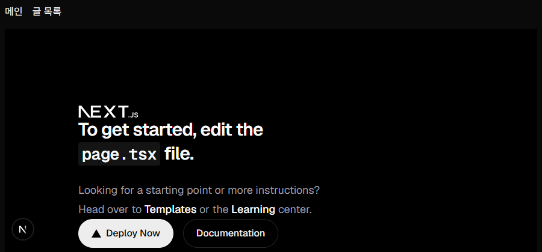
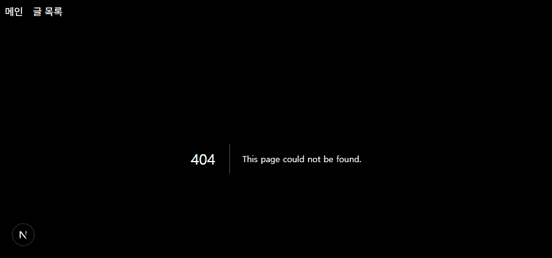
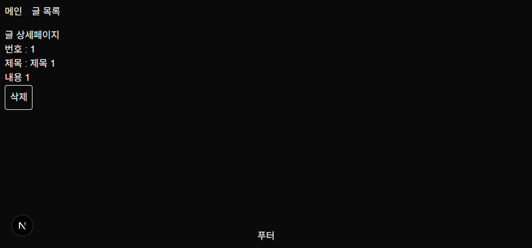
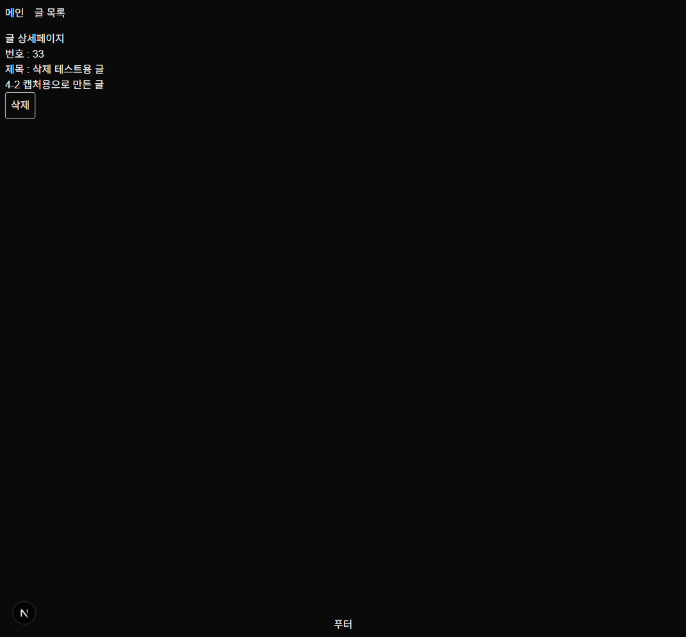

# p-14175-2 스프링부트 REST API + Next.js 게시판

- 수업: https://www.slog.gg/p/14175
- 참고 코드: [jhs512/p-14175-2](https://github.com/jhs512/p-14175-2)
- 백엔드: [jhs512/p-14172-2](https://github.com/jhs512/p-14172-2)의 `068` 태그 (Spring Boot, `http://localhost:8080`)
- 프론트엔드: Next.js 16 (App Router), TypeScript, Tailwind CSS (`http://localhost:3000`)

## 실행 방법

### 백엔드 (터미널 1)

```powershell
git clone https://github.com/jhs512/p-14172-2.git p-14172-2-backend
cd p-14172-2-backend
git checkout 068
./gradlew bootRun
```

- 068 백엔드에는 `localhost:3000`에서 오는 요청을 허용하는 CORS 설정(`WebMvcConfig`)이 이미 들어 있습니다.

### 프론트엔드 (터미널 2)

```powershell
pnpm install
pnpm dev
```

브라우저에서 http://localhost:3000 을 엽니다.

## 사용하는 백엔드 API

| 기능 | 메서드 | 주소 |
|---|---|---|
| 글 다건조회 | `GET` | `/api/v1/posts` |
| 글 단건조회 | `GET` | `/api/v1/posts/{id}` |
| 글 삭제 | `DELETE` | `/api/v1/posts/{id}` |
| 글 작성 | `POST` | `/api/v1/posts` |
| 글 수정 | `PUT` | `/api/v1/posts/{id}` |
| 댓글 다건조회 | `GET` | `/api/v1/posts/{postId}/comments` |
| 댓글 삭제 | `DELETE` | `/api/v1/posts/{postId}/comments/{id}` |
| 댓글 작성 | `POST` | `/api/v1/posts/{postId}/comments` |

## 진행 방식

기능 하나를 여러 커밋으로 나눠서 구현합니다. 커밋마다 바뀐 파일과 핵심 개념을 아래에 정리합니다.
커밋마다 브라우저 화면을 캡처해서 **전(이전 커밋) / 후(이 커밋)** 로 붙였습니다(`docs/images/`).

1. 홈
2. 글 다건조회
3. 글 단건조회
4. 글 삭제
5. 글 작성
6. 글 수정
7. 댓글 다건조회
8. 댓글 삭제
9. 댓글 작성

---

## 0. 프로젝트 생성

### 커밋 0-1: create-next-app으로 프로젝트 생성

```powershell
pnpm create next-app@16.4.6 p-14175-2 --ts --tailwind --eslint --app --src-dir --import-alias "@/*" --use-pnpm --react-compiler
```

| 옵션 | 의미 |
|---|---|
| `--ts` | TypeScript 사용 |
| `--tailwind` | 클래스 이름만으로 스타일을 주는 Tailwind CSS 사용 |
| `--eslint` | 코드 규칙 검사 도구 ESLint 사용 |
| `--app` | App Router 사용: `src/app` 폴더 구조가 곧 주소가 됨 |
| `--src-dir` | 소스 코드를 `src/` 아래에 둠 |
| `--import-alias "@/*"` | `@/lib/...`처럼 `src/` 기준으로 import 가능 |

**주요 파일**

| 파일 | 역할 |
|---|---|
| `src/app/layout.tsx` | 모든 페이지를 감싸는 공통 틀(`<html>`, `<body>`) |
| `src/app/page.tsx` | `/` 주소의 페이지 |
| `src/app/globals.css` | 전체 CSS. Tailwind를 불러옴 |
| `package.json` | 사용하는 라이브러리와 실행 명령(`pnpm dev` 등) |

**결과 화면** (`/`): create-next-app 기본 화면


### 커밋 0-2: README 작성

과제 개요, 실행 방법, 사용할 백엔드 API 목록을 정리했습니다.

**결과 화면**: README만 바꿨으므로 화면 변화 없음

---

## 1. 홈

### 커밋 1-1: 공통 레이아웃에 상단 메뉴 추가

**변경 파일**: `src/app/layout.tsx`

- `layout.tsx`는 **모든 페이지를 감싸는 틀**입니다. 각 페이지(`page.tsx`)의 내용은 `{children}` 자리에 들어갑니다. 그래서 여기에 넣은 메뉴는 어느 페이지에서나 보입니다.
- 화면 구조: `<header>`(메뉴) → `<main>`(페이지 내용) → `<footer>`(푸터)
- `<Link href="/posts">`: Next.js의 링크 컴포넌트입니다. 일반 `<a>` 태그와 달리 페이지 전체를 새로 불러오지 않고 바뀐 부분만 바꿔서 빠르게 이동합니다.
- `metadata`: 브라우저 탭에 보이는 제목(`title`)과 설명을 정합니다.
- `lang="ko"`: 페이지 언어를 한국어로 알립니다.
- Tailwind 클래스 예시
  - `flex`: 자식 요소를 가로로 나란히 놓음
  - `p-2`: 안쪽 여백, `rounded`: 모서리 둥글게, `hover:bg-gray-100`: 마우스를 올리면 회색 배경
  - `flex-grow`: `<main>`이 남는 세로 공간을 모두 차지해서 푸터가 화면 맨 아래로 내려감

**결과 화면**

| 전 | 후 |
|---|---|
|  |  |
| `/` 기본 화면 | `/` 위에 "메인 / 글 목록" 메뉴가 생김 |

### 커밋 1-2: 홈 페이지를 "안녕하세요."로 단순화

**변경 파일**: `src/app/page.tsx`

- create-next-app이 만든 기본 소개 화면을 지우고, 가운데에 "안녕하세요."만 보여 주는 홈으로 바꿨습니다.
- 컴포넌트 구조가 한눈에 보입니다: `export default function Page()` → `return (JSX)`
- 이 페이지의 `<div>`가 `layout.tsx`의 `{children}` 자리에 들어갑니다.
- Tailwind 클래스
  - `flex-grow`: `<main>`의 남는 공간을 모두 차지함
  - `flex items-center justify-center`: 내용을 세로·가로 가운데에 놓음
- 기본 화면에서만 쓰던 `next/image`와 `public/` 안의 이미지 import도 함께 사라졌습니다.

**결과 화면**

| 전 | 후 |
|---|---|
|  |  |
| `/` 메뉴 + 기본 화면 | `/` 메뉴 + 안녕하세요. + 푸터 |

---

## 2. 글 다건조회

### 커밋 2-1: 백엔드 주소(.env)와 글 타입(PostDto) 정의

**변경 파일**

| 파일 | 역할 |
|---|---|
| `.env` (새 파일) | `NEXT_PUBLIC_API_BASE_URL=http://localhost:8080` 백엔드 주소 |
| `src/type/post.ts` (새 파일) | 백엔드가 돌려주는 글 데이터의 모양(`PostDto` 타입) |
| `.gitignore` | `!.env` 한 줄 추가 |

**`.env`: 환경 변수 파일**

- 백엔드 주소를 코드 여러 곳에 직접 쓰면, 주소가 바뀔 때 전부 찾아 고쳐야 합니다. `.env` 한 곳에 두고 코드에서는 `process.env.NEXT_PUBLIC_API_BASE_URL`로 읽습니다. 스프링의 `application.yml`과 비슷한 역할입니다.
- 이름이 `NEXT_PUBLIC_`으로 시작해야 브라우저에서 실행되는 코드에서도 읽을 수 있습니다.
- 브라우저에 그대로 보이는 값이라 비밀번호 같은 비밀값은 넣으면 안 됩니다.
- create-next-app의 `.gitignore`는 `.env*`를 전부 커밋에서 뺍니다. 이 파일에는 비밀값이 없으므로 `!.env`(예외: 이 파일은 커밋함)를 추가했습니다.

**`PostDto` 타입: 데이터 모양 약속**

- 백엔드 `GET /api/v1/posts`의 응답 예시

  ```json
  [{ "id": 1, "createDate": "2026-...", "modifyDate": "2026-...", "title": "제목 1", "content": "내용 1" }]
  ```

- `type PostDto = { ... }`로 이 모양을 적어 두면, `post.titel`처럼 오타를 내거나 없는 필드를 쓸 때 TypeScript가 바로 빨간 줄로 알려 줍니다.
- 백엔드 Java record와 비교

  | Java (`PostDto`) | TypeScript |
  |---|---|
  | `int id` | `id: number` |
  | `LocalDateTime createDate` | `createDate: string` (JSON에서는 날짜가 문자열로 옴) |
  | `String title` | `title: string` |

- `export`를 붙여서 다른 파일에서 `import type { PostDto } from "@/type/post"`로 가져다 씁니다.
- 아직 이 타입을 쓰는 화면은 없습니다. 다음 커밋에서 사용합니다.

**결과 화면**: 설정과 타입만 추가했으므로 화면 변화 없음

### 커밋 2-2: `/posts` 페이지에서 글 목록 받아와 출력

**변경 파일**: `src/app/posts/page.tsx` (새 파일) → 주소 `/posts`

**동작 순서**

```
1. 첫 화면: posts가 null → "로딩중..." 표시
2. 화면이 그려진 직후 useEffect 실행 → fetch로 백엔드 GET /api/v1/posts 요청
3. 응답 JSON을 setPosts(글 목록)로 저장
4. state가 바뀌었으므로 React가 Page()를 다시 실행 → 이번엔 글 목록 표시
```

**핵심 개념**

- `"use client"`: 이 파일은 **브라우저에서 실행**되는 컴포넌트라는 표시입니다. `useState`, `useEffect`는 브라우저에서만 동작하므로 꼭 필요합니다.
- `useState`: 화면에 쓰이는 **값을 기억하는 상자**입니다.
  - `const [posts, setPosts] = useState<PostDto[] | null>(null);`
  - `posts`는 현재 값, `setPosts`는 값을 바꾸는 함수, `(null)`은 처음 값입니다.
  - `<PostDto[] | null>`: "글 배열이거나 null"이라는 타입입니다. `|`는 "또는"입니다.
  - 일반 변수를 바꾸면 화면이 그대로지만, **`setPosts`로 바꾸면 React가 화면을 다시 그립니다.**
- `useEffect(() => { ... }, [])`: 화면이 그려진 **뒤에** 실행할 코드입니다. 두 번째 인자 `[]`(빈 배열)는 "처음 한 번만 실행"이라는 뜻입니다. 백엔드 요청처럼 시간이 걸리는 일을 여기서 합니다.
- `fetch(주소)`: 브라우저에 내장된 HTTP 요청 함수입니다. 응답이 바로 오지 않으므로 `.then(...)`으로 "응답이 오면 할 일"을 이어 붙입니다.
  - `.then((res) => res.json())`: 응답 본문을 JSON으로 해석
  - `.then(setPosts)`: 해석한 글 목록을 state에 저장 (`.then((data) => setPosts(data))`의 줄임)
- `` `${process.env.NEXT_PUBLIC_API_BASE_URL}/api/v1/posts` ``: 2-1에서 만든 `.env` 값으로 주소를 만듭니다.

**화면 그리기 문법 (JSX)**

- `if (posts == null) return <div>로딩중...</div>;`: 아직 응답이 안 왔으면 여기서 끝냅니다. 이 줄 아래에서는 `posts`가 null이 아니라고 TypeScript가 알아서 판단합니다.
- `<> ... </>`: 이름 없는 묶음 태그(Fragment)입니다. JSX는 최상위 태그가 하나여야 하는데, 쓸데없는 `<div>`를 추가하고 싶지 않을 때 씁니다.
- `{조건 && <태그/>}`: 조건이 참일 때만 태그를 보여 줍니다. JSX 안에서는 `if`를 쓸 수 없어서 이렇게 씁니다.
- `posts.map((post) => <li>...</li>)`: 글 배열을 `<li>` 배열로 바꿔서 목록을 그립니다. Java Stream의 `map`과 같습니다.
- `key={post.id}`: 목록의 각 항목을 구분하는 이름표입니다. React가 어떤 항목이 바뀌었는지 알아내는 데 씁니다. 빠뜨리면 경고가 나옵니다.
- `<Link href={`/posts/${post.id}`}>`: 제목을 누르면 `/posts/1` 같은 상세 주소로 갑니다. 상세 페이지는 3번 기능에서 만듭니다.

**확인 방법**: 백엔드(`localhost:8080`)를 켠 상태에서 `pnpm dev` → 상단 메뉴 "글 목록"

**결과 화면**

| 전 | 후 |
|---|---|
|  |  |
| `/posts` 페이지가 없어서 404 | `/posts` 백엔드에서 받은 글 목록 |

> **주의: "Failed to fetch"가 뜰 때**
> 3000 포트를 다른 프로그램이 쓰고 있으면 `pnpm dev`가 3001 포트로 뜹니다. 백엔드 CORS 설정은 `localhost:3000`만 허용하므로 요청이 거절되고, 브라우저는 이유 없이 "Failed to fetch"만 보여 줍니다. 터미널에 `Local: http://localhost:3000`이 나오는지 확인하세요.

### 커밋 2-3: 백엔드 호출을 공용 함수 `apiFetch`로 분리

**변경 파일**

| 파일 | 내용 |
|---|---|
| `src/lib/backend/client.ts` (새 파일) | 공용 함수 `apiFetch` |
| `src/app/posts/page.tsx` | `fetch(...)` 3줄 → `apiFetch(...)` 1줄 |

**왜 분리하나?**

앞으로 글 단건조회, 삭제, 작성, 수정, 댓글까지 페이지마다 백엔드를 부릅니다. 그때마다 아래 두 가지를 반복하게 됩니다.

1. 주소 앞에 `process.env.NEXT_PUBLIC_API_BASE_URL` 붙이기
2. `.then((res) => res.json())`로 응답을 JSON으로 바꾸기

이 반복을 함수 하나로 모았습니다. 스프링에서 여러 컨트롤러가 공통으로 쓰는 코드를 서비스나 유틸 클래스로 빼는 것과 같은 이유입니다.

**전후 비교**

```tsx
// 전
fetch(`${process.env.NEXT_PUBLIC_API_BASE_URL}/api/v1/posts`)
  .then((res) => res.json())
  .then(setPosts);

// 후
apiFetch(`/api/v1/posts`).then(setPosts);
```

**`apiFetch` 읽는 법**

- `export const apiFetch = (url: string, options?: RequestInit) => { ... }`: 화살표 함수(`=>`)를 상수에 담은 것입니다. `function apiFetch(...) { ... }`와 같은 뜻입니다.
- `url: string`: `/api/v1/posts`처럼 주소 뒷부분만 받습니다.
- `options?: RequestInit`: `?`는 "생략 가능"이라는 뜻입니다. 지금은 GET만 쓰므로 생략하고, 나중에 삭제(`DELETE`)·작성(`POST`)에서 `{ method: "DELETE" }` 같은 옵션을 넘깁니다. `RequestInit`은 `fetch`가 받는 옵션의 타입입니다.
- `return fetch(...).then((res) => res.json())`: JSON으로 바꾼 결과를 돌려주므로, 부르는 쪽에서 `.then(setPosts)`처럼 바로 이어 쓸 수 있습니다.

**결과**: 화면은 2-2와 똑같습니다. 동작은 그대로 두고 코드 구조만 바꾸는 것을 **리팩터링**이라고 합니다.

**결과 화면**

| 전 | 후 |
|---|---|
|  |  |
| `/posts` (fetch 직접 사용) | `/posts` (apiFetch 사용) 화면 동일 |

---

## 3. 글 단건조회

### 커밋 3-1: `/posts/[id]` 상세 페이지

**변경 파일 (모두 새 파일)**

| 파일 | 역할 |
|---|---|
| `src/app/posts/[id]/page.tsx` | 글 상세 페이지. 주소 `/posts/1`, `/posts/2`, ... |
| `src/app/posts/[id]/loading.tsx` | 페이지가 준비되기 전에 잠깐 보여 줄 "로딩중..." 화면 |

**`[id]` 폴더: 동적 경로**

- 폴더 이름을 대괄호로 감싸면 **그 자리에 어떤 값이든 들어올 수 있는 주소**가 됩니다.
- `/posts/1`, `/posts/2`, `/posts/999` 모두 같은 `posts/[id]/page.tsx`가 처리하고, 주소의 숫자는 `id`라는 이름으로 꺼낼 수 있습니다.
- 스프링의 `@GetMapping("/posts/{id}")` + `@PathVariable int id`와 같은 개념입니다.

**코드 읽는 법**

```tsx
const { id: idStr } = useParams<{ id: string }>();
const id = Number(idStr);
```

- `useParams()`: 현재 주소의 동적 값들을 `{ id: "1" }` 같은 객체로 돌려줍니다.
- `{ id: idStr }`: 객체에서 `id`를 꺼내면서 이름을 `idStr`로 바꿉니다(구조 분해 + 이름 변경).
- 주소에서 꺼낸 값은 **항상 문자열**이라서 `Number(...)`로 숫자로 바꿉니다.

```tsx
useEffect(() => {
  apiFetch(`/api/v1/posts/${id}`).then(setPost);
}, [id]);
```

- 2-2와 같은 패턴입니다. 다른 점은 두 번째 인자가 `[]`가 아니라 `[id]`라는 것입니다.
- `[id]`: "처음 한 번 + **id가 바뀔 때마다** 다시 실행"이라는 뜻입니다. `/posts/1`에서 `/posts/2`로 이동하면 새 글을 다시 받아옵니다.
- 이 배열을 **의존성 배열**이라고 합니다. effect 안에서 쓰는 바깥 값(`id`)은 여기에 적습니다.

```tsx
<div style={{ whiteSpace: "pre-line" }}>{post.content}</div>
```

- 본문의 줄바꿈(`\n`)을 화면에서도 줄바꿈으로 보여 줍니다. HTML은 기본적으로 줄바꿈을 무시하기 때문입니다.
- `style={{ ... }}`: 바깥 `{ }`는 "JavaScript 값을 넣는다", 안쪽 `{ }`는 "객체"입니다.

**`loading.tsx`가 필요한 이유**

- 이 프로젝트는 create-next-app 기본값으로 `next.config.ts`에 `cacheComponents: true`가 켜져 있습니다. 이 설정에서는 Next.js가 빌드할 때 페이지를 미리 그려 두려고 합니다.
- 그런데 `useParams()`로 읽는 주소 값은 **실제로 접속해야** 알 수 있으므로 미리 그릴 수 없습니다. 그래서 `loading.tsx` 없이 `pnpm build`를 하면 아래 오류가 납니다.

  ```
  Route "/posts/[id]": Next.js encountered URL data `useParams()` in a Client Component outside of `<Suspense>`.
  ```

- 같은 폴더에 `loading.tsx`를 두면 Next.js가 페이지를 자동으로 `<Suspense>`로 감쌉니다. 그러면 "미리 그릴 때는 `loading.tsx` 화면을 쓰고, 실제 접속하면 `page.tsx`로 바꿔 끼운다"가 되어 오류가 사라집니다.

**확인 방법**: 글 목록에서 제목을 누르거나 http://localhost:3000/posts/1 접속

**결과 화면**

| 전 | 후 |
|---|---|
|  |  |
| `/posts/1` 페이지가 없어서 404 | `/posts/1` 글 번호, 제목, 내용 표시 |

### 커밋 3-2: 없는 글일 때 에러 처리

**변경 파일**

| 파일 | 내용 |
|---|---|
| `src/lib/backend/client.ts` | 실패 응답(`!res.ok`)이면 백엔드가 보낸 JSON을 에러로 던짐 |
| `src/app/posts/[id]/page.tsx` | `.catch`로 에러를 받아 `alert`로 알림 |

**문제 상황 (3-1까지)**

- 없는 글 `GET /api/v1/posts/9999`를 요청하면 백엔드는 이렇게 응답합니다.

  ```
  404
  {"resultCode":"404-1","msg":"해당 데이터가 존재하지 않습니다.","data":null}
  ```

- `fetch`는 **404, 500이어도 실패로 보지 않습니다.** 서버와 통신만 되면 성공으로 처리합니다. 그래서 이 에러 JSON이 그대로 `setPost`에 들어갔고, 화면에는 번호·제목이 빈 칸인 이상한 상세 페이지가 나왔습니다.

**해결 1: `apiFetch`에서 실패 응답을 에러로 바꾸기**

```ts
.then((res) => {
  if (!res.ok) {
    return res.json().then((errorData) => {
      throw errorData;
    });
  }

  return res.json();
});
```

- `res.ok`: 상태 코드가 200번대(200~299)면 `true`입니다.
- 실패면 본문(`{ resultCode, msg }`)을 읽은 뒤 `throw`로 던집니다. 던진 값은 `.then`들을 건너뛰고 가장 가까운 `.catch`로 갑니다.
- 공용 함수에 넣었으므로, 앞으로 모든 페이지에서 실패 응답이 똑같이 에러로 처리됩니다. 2-3에서 공용 함수로 분리한 효과입니다.

**해결 2: 페이지에서 `.catch`로 받기**

```tsx
apiFetch(`/api/v1/posts/${id}`)
  .then(setPost)
  .catch((error) => {
    alert(`${error.resultCode} : ${error.msg}`);
  });
```

- 성공하면 `.then(setPost)`, 실패하면 `.catch(...)`가 실행됩니다. Java의 `try { ... } catch (e) { ... }`와 같은 역할입니다.
- `error`는 `apiFetch`가 던진 백엔드 JSON이므로 `error.resultCode`, `error.msg`를 꺼낼 수 있습니다.
- 결과: `404-1 : 해당 데이터가 존재하지 않습니다.` 알림창이 뜨고, `post`는 `null` 그대로라 화면은 "로딩중..."에 머뭅니다.

**확인 방법**: http://localhost:3000/posts/9999 접속

> **알림창이 두 번 뜨는 이유**
> 개발 모드(`pnpm dev`)에서는 React가 실수를 찾아내려고 `useEffect`를 일부러 두 번 실행합니다. 그래서 백엔드 요청도, 알림창도 두 번 생깁니다. 버그가 아니며 `pnpm build` 후 실행하면 한 번만 뜹니다.

**결과 화면**

| 전 | 후 |
|---|---|
|  |  |
| 에러 JSON이 글로 저장되어 번호·제목이 빈 칸 | `404-1 : 해당 데이터가 존재하지 않습니다.` 알림창이 뜨고, 확인을 누르면 "로딩중..."에 머묾 |

알림창은 브라우저 바깥 창이라 캡처에 찍히지 않아 문구로 적었습니다.

---

## 4. 글 삭제

### 커밋 4-1: 상세 페이지에 삭제 버튼 + DELETE 요청

**변경 파일**: `src/app/posts/[id]/page.tsx`

**동작 순서**

```
1. "삭제" 버튼 클릭 → deletePost() 실행
2. confirm("1번 글을 정말로 삭제하시겠습니까?") → 취소하면 여기서 끝
3. 확인하면 DELETE /api/v1/posts/1 요청
4. 성공: 백엔드 응답 {"resultCode":"200-1","msg":"1번 글이 삭제되었습니다."} 의 msg를 alert
   실패: .catch에서 resultCode와 msg를 alert
```

**핵심 개념**

- `<button onClick={deletePost}>`: 버튼을 누르면 `deletePost` 함수를 실행합니다.
  - `onClick={deletePost}`처럼 **함수 자체**를 넘깁니다. `onClick={deletePost()}`라고 쓰면 화면을 그릴 때 바로 실행돼 버립니다.
- `const deletePost = () => { ... }`: 컴포넌트 함수 **안에** 만든 함수라서 `post` 같은 바깥 변수를 그대로 쓸 수 있습니다.
- `confirm(문구)`: 브라우저 기본 확인 창입니다. 확인을 누르면 `true`, 취소를 누르면 `false`를 돌려줍니다. `if (!confirm(...)) return;`은 "취소면 아무것도 안 하고 끝"입니다.
- `apiFetch(주소, { method: "DELETE" })`: 2-3에서 만들어 둔 두 번째 인자 `options`를 처음 씁니다. 생략하면 GET, `method`를 주면 그 방식으로 요청합니다.
- 백엔드 삭제 API는 `RsData`(`resultCode`, `msg`, `data`)를 돌려주므로 `data.msg`로 안내 문구를 꺼냅니다.

**아직 남은 문제**: 삭제는 되지만 화면은 지워진 글을 그대로 보여 줍니다. 다음 커밋에서 삭제 후 글 목록으로 이동시킵니다.

**결과 화면**

| 전 | 후 |
|---|---|
|  |  |
| `/posts/1` 삭제 버튼 없음 | `/posts/1` 아래에 "삭제" 버튼이 생김 |

### 커밋 4-2: 삭제 성공 후 글 목록으로 이동

**변경 파일**: `src/app/posts/[id]/page.tsx`

```tsx
const router = useRouter();
...
.then((data) => {
  alert(data.msg);
  router.replace("/posts");
})
```

- `useRouter()`: **코드로** 페이지를 이동할 때 쓰는 도구입니다. `<Link>`는 사용자가 눌러야 이동하지만, `router`는 "삭제가 끝나면"처럼 원하는 시점에 이동시킬 수 있습니다.
- `next/navigation`에서 가져옵니다. `useParams`와 같은 곳입니다.
- `alert` 다음 줄에 있으므로, 사용자가 알림창의 확인을 누른 뒤에 이동합니다.

**`push`와 `replace`의 차이**

브라우저는 방문한 페이지를 기록(히스토리)에 쌓고, 뒤로 가기를 누르면 그 기록을 거꾸로 따라갑니다.

| 방법 | 기록 변화 (`/posts` → `/posts/2`에서 삭제) | 뒤로 가기를 누르면 |
|---|---|---|
| `router.push("/posts")` | `/posts` → `/posts/2` → `/posts` (쌓음) | 지워진 `/posts/2`로 돌아가 404 알림 |
| `router.replace("/posts")` | `/posts` → `/posts` (`/posts/2`를 바꿔치기) | 그 전 페이지로 감 |

삭제된 글 페이지는 다시 볼 일이 없으므로 기록에서 지우는 `replace`를 씁니다.

**결과 화면** (캡처용으로 만든 33번 글을 삭제)

| 전 | 후 |
|---|---|
|  |  |
| `/posts/33`에서 "삭제" 클릭 | `33번 글을 정말로 삭제하시겠습니까?` 확인 → `33번 글이 삭제되었습니다.` 확인 → `/posts`로 이동, 33번이 목록에 없음 |

4-1까지는 알림창을 닫아도 지워진 33번 글 화면에 그대로 머물렀습니다.
