# p-14175-2 스프링부트 REST API + Next.js 게시판

- 수업: https://www.slog.gg/p/14175
- 참고 코드: [jhs512/p-14175-2](https://github.com/jhs512/p-14175-2)
- 백엔드: [jhs512/p-14172-2](https://github.com/jhs512/p-14172-2)의 `068` 태그 (Spring Boot, `http://localhost:8080`)
- 프론트엔드: Next.js 16 (App Router), TypeScript, Tailwind CSS (`http://localhost:3000`)

## 실행 방법

### 백엔드 (터미널 1)

```powershell
git clone https://github.com/jhs512/p-14172-2.git p-14172-2-backend
cd p-14172-2-backend
git checkout 068
./gradlew bootRun
```

- 068 백엔드에는 `localhost:3000`에서 오는 요청을 허용하는 CORS 설정(`WebMvcConfig`)이 이미 들어 있습니다.

### 프론트엔드 (터미널 2)

```powershell
pnpm install
pnpm dev
```

브라우저에서 http://localhost:3000 을 엽니다.

## 사용하는 백엔드 API

| 기능 | 메서드 | 주소 |
|---|---|---|
| 글 다건조회 | `GET` | `/api/v1/posts` |
| 글 단건조회 | `GET` | `/api/v1/posts/{id}` |
| 글 삭제 | `DELETE` | `/api/v1/posts/{id}` |
| 글 작성 | `POST` | `/api/v1/posts` |
| 글 수정 | `PUT` | `/api/v1/posts/{id}` |
| 댓글 다건조회 | `GET` | `/api/v1/posts/{postId}/comments` |
| 댓글 삭제 | `DELETE` | `/api/v1/posts/{postId}/comments/{id}` |
| 댓글 작성 | `POST` | `/api/v1/posts/{postId}/comments` |

## 진행 방식

기능 하나를 여러 커밋으로 나눠서 구현합니다. 커밋마다 바뀐 파일과 핵심 개념을 아래에 정리합니다.
커밋마다 브라우저 화면을 캡처해서 **전(이전 커밋) / 후(이 커밋)** 로 붙였습니다(`docs/images/`).

1. 홈
2. 글 다건조회
3. 글 단건조회
4. 글 삭제
5. 글 작성
6. 글 수정
7. 댓글 다건조회
8. 댓글 삭제
9. 댓글 작성
10. 리팩토링 (강의 35 ~ 48강. 35·36·38~40강 내용은 3-2, 5-2, 7-2, 9-1에서 이미 적용)
11. 댓글 수정 (강의 49 ~ 51강)

---

## 0. 프로젝트 생성

### 커밋 0-1: create-next-app으로 프로젝트 생성

```powershell
pnpm create next-app@16.4.6 p-14175-2 --ts --tailwind --eslint --app --src-dir --import-alias "@/*" --use-pnpm --react-compiler
```

| 옵션 | 의미 |
|---|---|
| `--ts` | TypeScript 사용 |
| `--tailwind` | 클래스 이름만으로 스타일을 주는 Tailwind CSS 사용 |
| `--eslint` | 코드 규칙 검사 도구 ESLint 사용 |
| `--app` | App Router 사용: `src/app` 폴더 구조가 곧 주소가 됨 |
| `--src-dir` | 소스 코드를 `src/` 아래에 둠 |
| `--import-alias "@/*"` | `@/lib/...`처럼 `src/` 기준으로 import 가능 |

**주요 파일**

| 파일 | 역할 |
|---|---|
| `src/app/layout.tsx` | 모든 페이지를 감싸는 공통 틀(`<html>`, `<body>`) |
| `src/app/page.tsx` | `/` 주소의 페이지 |
| `src/app/globals.css` | 전체 CSS. Tailwind를 불러옴 |
| `package.json` | 사용하는 라이브러리와 실행 명령(`pnpm dev` 등) |

**결과 화면** (`/`): create-next-app 기본 화면


### 커밋 0-2: README 작성

과제 개요, 실행 방법, 사용할 백엔드 API 목록을 정리했습니다.

**결과 화면**: README만 바꿨으므로 화면 변화 없음

---

## 1. 홈

### 커밋 1-1: 공통 레이아웃에 상단 메뉴 추가

**변경 파일**: `src/app/layout.tsx`

- `layout.tsx`는 **모든 페이지를 감싸는 틀**입니다. 각 페이지(`page.tsx`)의 내용은 `{children}` 자리에 들어갑니다. 그래서 여기에 넣은 메뉴는 어느 페이지에서나 보입니다.
- 화면 구조: `<header>`(메뉴) → `<main>`(페이지 내용) → `<footer>`(푸터)
- `<Link href="/posts">`: Next.js의 링크 컴포넌트입니다. 일반 `<a>` 태그와 달리 페이지 전체를 새로 불러오지 않고 바뀐 부분만 바꿔서 빠르게 이동합니다.
- `metadata`: 브라우저 탭에 보이는 제목(`title`)과 설명을 정합니다.
- `lang="ko"`: 페이지 언어를 한국어로 알립니다.
- Tailwind 클래스 예시
  - `flex`: 자식 요소를 가로로 나란히 놓음
  - `p-2`: 안쪽 여백, `rounded`: 모서리 둥글게, `hover:bg-gray-100`: 마우스를 올리면 회색 배경
  - `flex-grow`: `<main>`이 남는 세로 공간을 모두 차지해서 푸터가 화면 맨 아래로 내려감

**결과 화면**

| 전 | 후 |
|---|---|
|  |  |
| `/` 기본 화면 | `/` 위에 "메인 / 글 목록" 메뉴가 생김 |

### 커밋 1-2: 홈 페이지를 "안녕하세요."로 단순화

**변경 파일**: `src/app/page.tsx`

- create-next-app이 만든 기본 소개 화면을 지우고, 가운데에 "안녕하세요."만 보여 주는 홈으로 바꿨습니다.
- 컴포넌트 구조가 한눈에 보입니다: `export default function Page()` → `return (JSX)`
- 이 페이지의 `<div>`가 `layout.tsx`의 `{children}` 자리에 들어갑니다.
- Tailwind 클래스
  - `flex-grow`: `<main>`의 남는 공간을 모두 차지함
  - `flex items-center justify-center`: 내용을 세로·가로 가운데에 놓음
- 기본 화면에서만 쓰던 `next/image`와 `public/` 안의 이미지 import도 함께 사라졌습니다.

**결과 화면**

| 전 | 후 |
|---|---|
|  |  |
| `/` 메뉴 + 기본 화면 | `/` 메뉴 + 안녕하세요. + 푸터 |

---

## 2. 글 다건조회

### 커밋 2-1: 백엔드 주소(.env)와 글 타입(PostDto) 정의

**변경 파일**

| 파일 | 역할 |
|---|---|
| `.env` (새 파일) | `NEXT_PUBLIC_API_BASE_URL=http://localhost:8080` 백엔드 주소 |
| `src/type/post.ts` (새 파일) | 백엔드가 돌려주는 글 데이터의 모양(`PostDto` 타입) |
| `.gitignore` | `!.env` 한 줄 추가 |

**`.env`: 환경 변수 파일**

- 백엔드 주소를 코드 여러 곳에 직접 쓰면, 주소가 바뀔 때 전부 찾아 고쳐야 합니다. `.env` 한 곳에 두고 코드에서는 `process.env.NEXT_PUBLIC_API_BASE_URL`로 읽습니다. 스프링의 `application.yml`과 비슷한 역할입니다.
- 이름이 `NEXT_PUBLIC_`으로 시작해야 브라우저에서 실행되는 코드에서도 읽을 수 있습니다.
- 브라우저에 그대로 보이는 값이라 비밀번호 같은 비밀값은 넣으면 안 됩니다.
- create-next-app의 `.gitignore`는 `.env*`를 전부 커밋에서 뺍니다. 이 파일에는 비밀값이 없으므로 `!.env`(예외: 이 파일은 커밋함)를 추가했습니다.

**`PostDto` 타입: 데이터 모양 약속**

- 백엔드 `GET /api/v1/posts`의 응답 예시

  ```json
  [{ "id": 1, "createDate": "2026-...", "modifyDate": "2026-...", "title": "제목 1", "content": "내용 1" }]
  ```

- `type PostDto = { ... }`로 이 모양을 적어 두면, `post.titel`처럼 오타를 내거나 없는 필드를 쓸 때 TypeScript가 바로 빨간 줄로 알려 줍니다.
- 백엔드 Java record와 비교

  | Java (`PostDto`) | TypeScript |
  |---|---|
  | `int id` | `id: number` |
  | `LocalDateTime createDate` | `createDate: string` (JSON에서는 날짜가 문자열로 옴) |
  | `String title` | `title: string` |

- `export`를 붙여서 다른 파일에서 `import type { PostDto } from "@/type/post"`로 가져다 씁니다.
- 아직 이 타입을 쓰는 화면은 없습니다. 다음 커밋에서 사용합니다.

**결과 화면**: 설정과 타입만 추가했으므로 화면 변화 없음

### 커밋 2-2: `/posts` 페이지에서 글 목록 받아와 출력

**변경 파일**: `src/app/posts/page.tsx` (새 파일) → 주소 `/posts`

**동작 순서**

```
1. 첫 화면: posts가 null → "로딩중..." 표시
2. 화면이 그려진 직후 useEffect 실행 → fetch로 백엔드 GET /api/v1/posts 요청
3. 응답 JSON을 setPosts(글 목록)로 저장
4. state가 바뀌었으므로 React가 Page()를 다시 실행 → 이번엔 글 목록 표시
```

**핵심 개념**

- `"use client"`: 이 파일은 **브라우저에서 실행**되는 컴포넌트라는 표시입니다. `useState`, `useEffect`는 브라우저에서만 동작하므로 꼭 필요합니다.
- `useState`: 화면에 쓰이는 **값을 기억하는 상자**입니다.
  - `const [posts, setPosts] = useState<PostDto[] | null>(null);`
  - `posts`는 현재 값, `setPosts`는 값을 바꾸는 함수, `(null)`은 처음 값입니다.
  - `<PostDto[] | null>`: "글 배열이거나 null"이라는 타입입니다. `|`는 "또는"입니다.
  - 일반 변수를 바꾸면 화면이 그대로지만, **`setPosts`로 바꾸면 React가 화면을 다시 그립니다.**
- `useEffect(() => { ... }, [])`: 화면이 그려진 **뒤에** 실행할 코드입니다. 두 번째 인자 `[]`(빈 배열)는 "처음 한 번만 실행"이라는 뜻입니다. 백엔드 요청처럼 시간이 걸리는 일을 여기서 합니다.
- `fetch(주소)`: 브라우저에 내장된 HTTP 요청 함수입니다. 응답이 바로 오지 않으므로 `.then(...)`으로 "응답이 오면 할 일"을 이어 붙입니다.
  - `.then((res) => res.json())`: 응답 본문을 JSON으로 해석
  - `.then(setPosts)`: 해석한 글 목록을 state에 저장 (`.then((data) => setPosts(data))`의 줄임)
- `` `${process.env.NEXT_PUBLIC_API_BASE_URL}/api/v1/posts` ``: 2-1에서 만든 `.env` 값으로 주소를 만듭니다.

**화면 그리기 문법 (JSX)**

- `if (posts == null) return <div>로딩중...</div>;`: 아직 응답이 안 왔으면 여기서 끝냅니다. 이 줄 아래에서는 `posts`가 null이 아니라고 TypeScript가 알아서 판단합니다.
- `<> ... </>`: 이름 없는 묶음 태그(Fragment)입니다. JSX는 최상위 태그가 하나여야 하는데, 쓸데없는 `<div>`를 추가하고 싶지 않을 때 씁니다.
- `{조건 && <태그/>}`: 조건이 참일 때만 태그를 보여 줍니다. JSX 안에서는 `if`를 쓸 수 없어서 이렇게 씁니다.
- `posts.map((post) => <li>...</li>)`: 글 배열을 `<li>` 배열로 바꿔서 목록을 그립니다. Java Stream의 `map`과 같습니다.
- `key={post.id}`: 목록의 각 항목을 구분하는 이름표입니다. React가 어떤 항목이 바뀌었는지 알아내는 데 씁니다. 빠뜨리면 경고가 나옵니다.
- `<Link href={`/posts/${post.id}`}>`: 제목을 누르면 `/posts/1` 같은 상세 주소로 갑니다. 상세 페이지는 3번 기능에서 만듭니다.

**확인 방법**: 백엔드(`localhost:8080`)를 켠 상태에서 `pnpm dev` → 상단 메뉴 "글 목록"

**결과 화면**

| 전 | 후 |
|---|---|
|  |  |
| `/posts` 페이지가 없어서 404 | `/posts` 백엔드에서 받은 글 목록 |

> **주의: "Failed to fetch"가 뜰 때**
> 3000 포트를 다른 프로그램이 쓰고 있으면 `pnpm dev`가 3001 포트로 뜹니다. 백엔드 CORS 설정은 `localhost:3000`만 허용하므로 요청이 거절되고, 브라우저는 이유 없이 "Failed to fetch"만 보여 줍니다. 터미널에 `Local: http://localhost:3000`이 나오는지 확인하세요.

### 커밋 2-3: 백엔드 호출을 공용 함수 `apiFetch`로 분리

**변경 파일**

| 파일 | 내용 |
|---|---|
| `src/lib/backend/client.ts` (새 파일) | 공용 함수 `apiFetch` |
| `src/app/posts/page.tsx` | `fetch(...)` 3줄 → `apiFetch(...)` 1줄 |

**왜 분리하나?**

앞으로 글 단건조회, 삭제, 작성, 수정, 댓글까지 페이지마다 백엔드를 부릅니다. 그때마다 아래 두 가지를 반복하게 됩니다.

1. 주소 앞에 `process.env.NEXT_PUBLIC_API_BASE_URL` 붙이기
2. `.then((res) => res.json())`로 응답을 JSON으로 바꾸기

이 반복을 함수 하나로 모았습니다. 스프링에서 여러 컨트롤러가 공통으로 쓰는 코드를 서비스나 유틸 클래스로 빼는 것과 같은 이유입니다.

**전후 비교**

```tsx
// 전
fetch(`${process.env.NEXT_PUBLIC_API_BASE_URL}/api/v1/posts`)
  .then((res) => res.json())
  .then(setPosts);

// 후
apiFetch(`/api/v1/posts`).then(setPosts);
```

**`apiFetch` 읽는 법**

- `export const apiFetch = (url: string, options?: RequestInit) => { ... }`: 화살표 함수(`=>`)를 상수에 담은 것입니다. `function apiFetch(...) { ... }`와 같은 뜻입니다.
- `url: string`: `/api/v1/posts`처럼 주소 뒷부분만 받습니다.
- `options?: RequestInit`: `?`는 "생략 가능"이라는 뜻입니다. 지금은 GET만 쓰므로 생략하고, 나중에 삭제(`DELETE`)·작성(`POST`)에서 `{ method: "DELETE" }` 같은 옵션을 넘깁니다. `RequestInit`은 `fetch`가 받는 옵션의 타입입니다.
- `return fetch(...).then((res) => res.json())`: JSON으로 바꾼 결과를 돌려주므로, 부르는 쪽에서 `.then(setPosts)`처럼 바로 이어 쓸 수 있습니다.

**결과**: 화면은 2-2와 똑같습니다. 동작은 그대로 두고 코드 구조만 바꾸는 것을 **리팩터링**이라고 합니다.

**결과 화면**

| 전 | 후 |
|---|---|
|  |  |
| `/posts` (fetch 직접 사용) | `/posts` (apiFetch 사용) 화면 동일 |

---

## 3. 글 단건조회

### 커밋 3-1: `/posts/[id]` 상세 페이지

**변경 파일 (모두 새 파일)**

| 파일 | 역할 |
|---|---|
| `src/app/posts/[id]/page.tsx` | 글 상세 페이지. 주소 `/posts/1`, `/posts/2`, ... |
| `src/app/posts/[id]/loading.tsx` | 페이지가 준비되기 전에 잠깐 보여 줄 "로딩중..." 화면 |

**`[id]` 폴더: 동적 경로**

- 폴더 이름을 대괄호로 감싸면 **그 자리에 어떤 값이든 들어올 수 있는 주소**가 됩니다.
- `/posts/1`, `/posts/2`, `/posts/999` 모두 같은 `posts/[id]/page.tsx`가 처리하고, 주소의 숫자는 `id`라는 이름으로 꺼낼 수 있습니다.
- 스프링의 `@GetMapping("/posts/{id}")` + `@PathVariable int id`와 같은 개념입니다.

**코드 읽는 법**

```tsx
const { id: idStr } = useParams<{ id: string }>();
const id = Number(idStr);
```

- `useParams()`: 현재 주소의 동적 값들을 `{ id: "1" }` 같은 객체로 돌려줍니다.
- `{ id: idStr }`: 객체에서 `id`를 꺼내면서 이름을 `idStr`로 바꿉니다(구조 분해 + 이름 변경).
- 주소에서 꺼낸 값은 **항상 문자열**이라서 `Number(...)`로 숫자로 바꿉니다.

```tsx
useEffect(() => {
  apiFetch(`/api/v1/posts/${id}`).then(setPost);
}, [id]);
```

- 2-2와 같은 패턴입니다. 다른 점은 두 번째 인자가 `[]`가 아니라 `[id]`라는 것입니다.
- `[id]`: "처음 한 번 + **id가 바뀔 때마다** 다시 실행"이라는 뜻입니다. `/posts/1`에서 `/posts/2`로 이동하면 새 글을 다시 받아옵니다.
- 이 배열을 **의존성 배열**이라고 합니다. effect 안에서 쓰는 바깥 값(`id`)은 여기에 적습니다.

```tsx
<div style={{ whiteSpace: "pre-line" }}>{post.content}</div>
```

- 본문의 줄바꿈(`\n`)을 화면에서도 줄바꿈으로 보여 줍니다. HTML은 기본적으로 줄바꿈을 무시하기 때문입니다.
- `style={{ ... }}`: 바깥 `{ }`는 "JavaScript 값을 넣는다", 안쪽 `{ }`는 "객체"입니다.

**`loading.tsx`가 필요한 이유**

- 이 프로젝트는 create-next-app 기본값으로 `next.config.ts`에 `cacheComponents: true`가 켜져 있습니다. 이 설정에서는 Next.js가 빌드할 때 페이지를 미리 그려 두려고 합니다.
- 그런데 `useParams()`로 읽는 주소 값은 **실제로 접속해야** 알 수 있으므로 미리 그릴 수 없습니다. 그래서 `loading.tsx` 없이 `pnpm build`를 하면 아래 오류가 납니다.

  ```
  Route "/posts/[id]": Next.js encountered URL data `useParams()` in a Client Component outside of `<Suspense>`.
  ```

- 같은 폴더에 `loading.tsx`를 두면 Next.js가 페이지를 자동으로 `<Suspense>`로 감쌉니다. 그러면 "미리 그릴 때는 `loading.tsx` 화면을 쓰고, 실제 접속하면 `page.tsx`로 바꿔 끼운다"가 되어 오류가 사라집니다.

**확인 방법**: 글 목록에서 제목을 누르거나 http://localhost:3000/posts/1 접속

**결과 화면**

| 전 | 후 |
|---|---|
|  |  |
| `/posts/1` 페이지가 없어서 404 | `/posts/1` 글 번호, 제목, 내용 표시 |

### 커밋 3-2: 없는 글일 때 에러 처리

**변경 파일**

| 파일 | 내용 |
|---|---|
| `src/lib/backend/client.ts` | 실패 응답(`!res.ok`)이면 백엔드가 보낸 JSON을 에러로 던짐 |
| `src/app/posts/[id]/page.tsx` | `.catch`로 에러를 받아 `alert`로 알림 |

**문제 상황 (3-1까지)**

- 없는 글 `GET /api/v1/posts/9999`를 요청하면 백엔드는 이렇게 응답합니다.

  ```
  404
  {"resultCode":"404-1","msg":"해당 데이터가 존재하지 않습니다.","data":null}
  ```

- `fetch`는 **404, 500이어도 실패로 보지 않습니다.** 서버와 통신만 되면 성공으로 처리합니다. 그래서 이 에러 JSON이 그대로 `setPost`에 들어갔고, 화면에는 번호·제목이 빈 칸인 이상한 상세 페이지가 나왔습니다.

**해결 1: `apiFetch`에서 실패 응답을 에러로 바꾸기**

```ts
.then((res) => {
  if (!res.ok) {
    return res.json().then((errorData) => {
      throw errorData;
    });
  }

  return res.json();
});
```

- `res.ok`: 상태 코드가 200번대(200~299)면 `true`입니다.
- 실패면 본문(`{ resultCode, msg }`)을 읽은 뒤 `throw`로 던집니다. 던진 값은 `.then`들을 건너뛰고 가장 가까운 `.catch`로 갑니다.
- 공용 함수에 넣었으므로, 앞으로 모든 페이지에서 실패 응답이 똑같이 에러로 처리됩니다. 2-3에서 공용 함수로 분리한 효과입니다.

**해결 2: 페이지에서 `.catch`로 받기**

```tsx
apiFetch(`/api/v1/posts/${id}`)
  .then(setPost)
  .catch((error) => {
    alert(`${error.resultCode} : ${error.msg}`);
  });
```

- 성공하면 `.then(setPost)`, 실패하면 `.catch(...)`가 실행됩니다. Java의 `try { ... } catch (e) { ... }`와 같은 역할입니다.
- `error`는 `apiFetch`가 던진 백엔드 JSON이므로 `error.resultCode`, `error.msg`를 꺼낼 수 있습니다.
- 결과: `404-1 : 해당 데이터가 존재하지 않습니다.` 알림창이 뜨고, `post`는 `null` 그대로라 화면은 "로딩중..."에 머뭅니다.

**확인 방법**: http://localhost:3000/posts/9999 접속

> **알림창이 두 번 뜨는 이유**
> 개발 모드(`pnpm dev`)에서는 React가 실수를 찾아내려고 `useEffect`를 일부러 두 번 실행합니다. 그래서 백엔드 요청도, 알림창도 두 번 생깁니다. 버그가 아니며 `pnpm build` 후 실행하면 한 번만 뜹니다.

**결과 화면**

| 전 | 후 |
|---|---|
|  | 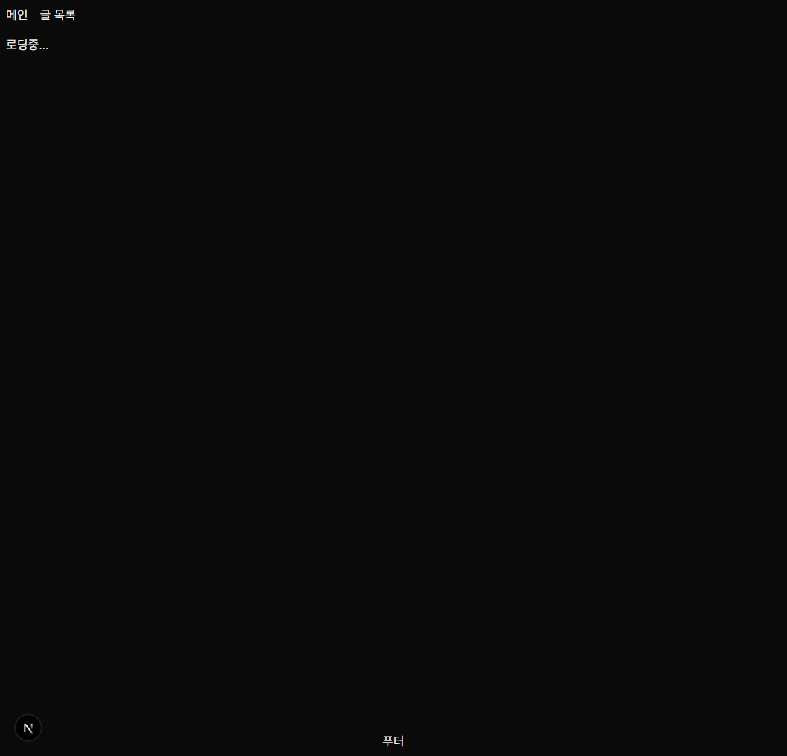 |
| 에러 JSON이 글로 저장되어 번호·제목이 빈 칸 | `404-1 : 해당 데이터가 존재하지 않습니다.` 알림창이 뜨고, 확인을 누르면 "로딩중..."에 머묾 |

**알림창**: `/posts/9999`에 들어가면 뜨는 알림창 (확인을 누르면 위 "후" 화면이 됨)

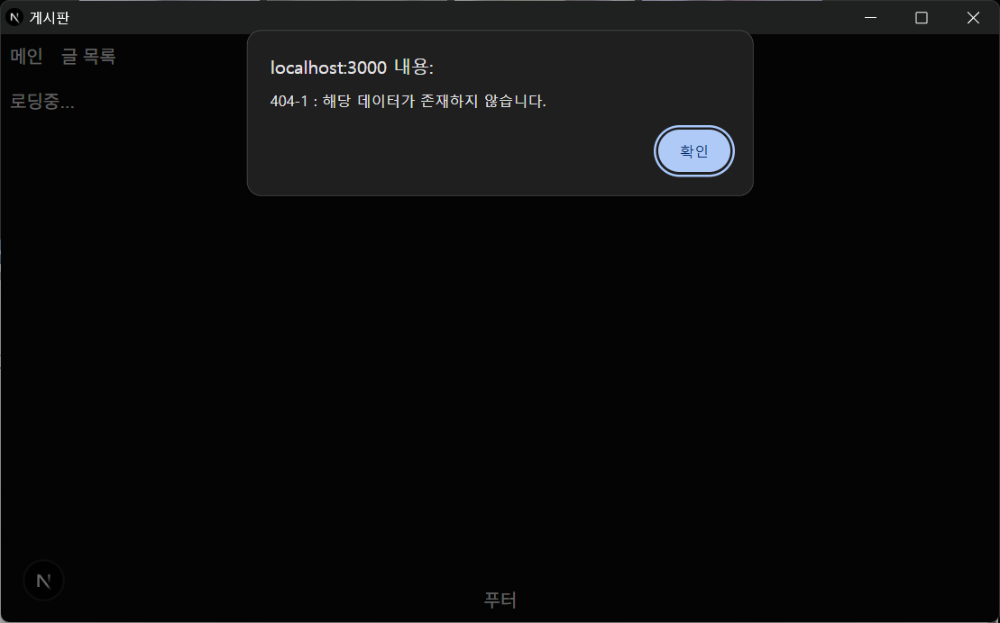

---

## 4. 글 삭제

### 커밋 4-1: 상세 페이지에 삭제 버튼 + DELETE 요청

**변경 파일**: `src/app/posts/[id]/page.tsx`

**동작 순서**

```
1. "삭제" 버튼 클릭 → deletePost() 실행
2. confirm("1번 글을 정말로 삭제하시겠습니까?") → 취소하면 여기서 끝
3. 확인하면 DELETE /api/v1/posts/1 요청
4. 성공: 백엔드 응답 {"resultCode":"200-1","msg":"1번 글이 삭제되었습니다."} 의 msg를 alert
   실패: .catch에서 resultCode와 msg를 alert
```

**핵심 개념**

- `<button onClick={deletePost}>`: 버튼을 누르면 `deletePost` 함수를 실행합니다.
  - `onClick={deletePost}`처럼 **함수 자체**를 넘깁니다. `onClick={deletePost()}`라고 쓰면 화면을 그릴 때 바로 실행돼 버립니다.
- `const deletePost = () => { ... }`: 컴포넌트 함수 **안에** 만든 함수라서 `post` 같은 바깥 변수를 그대로 쓸 수 있습니다.
- `confirm(문구)`: 브라우저 기본 확인 창입니다. 확인을 누르면 `true`, 취소를 누르면 `false`를 돌려줍니다. `if (!confirm(...)) return;`은 "취소면 아무것도 안 하고 끝"입니다.
- `apiFetch(주소, { method: "DELETE" })`: 2-3에서 만들어 둔 두 번째 인자 `options`를 처음 씁니다. 생략하면 GET, `method`를 주면 그 방식으로 요청합니다.
- 백엔드 삭제 API는 `RsData`(`resultCode`, `msg`, `data`)를 돌려주므로 `data.msg`로 안내 문구를 꺼냅니다.

**아직 남은 문제**: 삭제는 되지만 화면은 지워진 글을 그대로 보여 줍니다. 다음 커밋에서 삭제 후 글 목록으로 이동시킵니다.

**결과 화면**

| 전 | 후 |
|---|---|
| 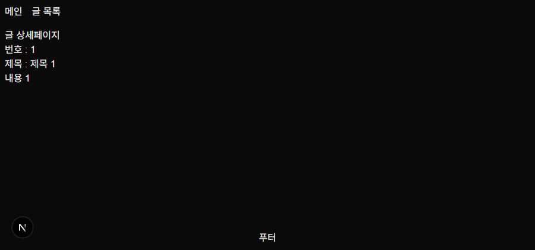 |  |
| `/posts/1` 삭제 버튼 없음 | `/posts/1` 아래에 "삭제" 버튼이 생김 |

### 커밋 4-2: 삭제 성공 후 글 목록으로 이동

**변경 파일**: `src/app/posts/[id]/page.tsx`

```tsx
const router = useRouter();
...
.then((data) => {
  alert(data.msg);
  router.replace("/posts");
})
```

- `useRouter()`: **코드로** 페이지를 이동할 때 쓰는 도구입니다. `<Link>`는 사용자가 눌러야 이동하지만, `router`는 "삭제가 끝나면"처럼 원하는 시점에 이동시킬 수 있습니다.
- `next/navigation`에서 가져옵니다. `useParams`와 같은 곳입니다.
- `alert` 다음 줄에 있으므로, 사용자가 알림창의 확인을 누른 뒤에 이동합니다.

**`push`와 `replace`의 차이**

브라우저는 방문한 페이지를 기록(히스토리)에 쌓고, 뒤로 가기를 누르면 그 기록을 거꾸로 따라갑니다.

| 방법 | 기록 변화 (`/posts` → `/posts/2`에서 삭제) | 뒤로 가기를 누르면 |
|---|---|---|
| `router.push("/posts")` | `/posts` → `/posts/2` → `/posts` (쌓음) | 지워진 `/posts/2`로 돌아가 404 알림 |
| `router.replace("/posts")` | `/posts` → `/posts` (`/posts/2`를 바꿔치기) | 그 전 페이지로 감 |

삭제된 글 페이지는 다시 볼 일이 없으므로 기록에서 지우는 `replace`를 씁니다.

**결과 화면** (캡처용으로 만든 33번 글을 삭제)

| 전 | 후 |
|---|---|
|  | 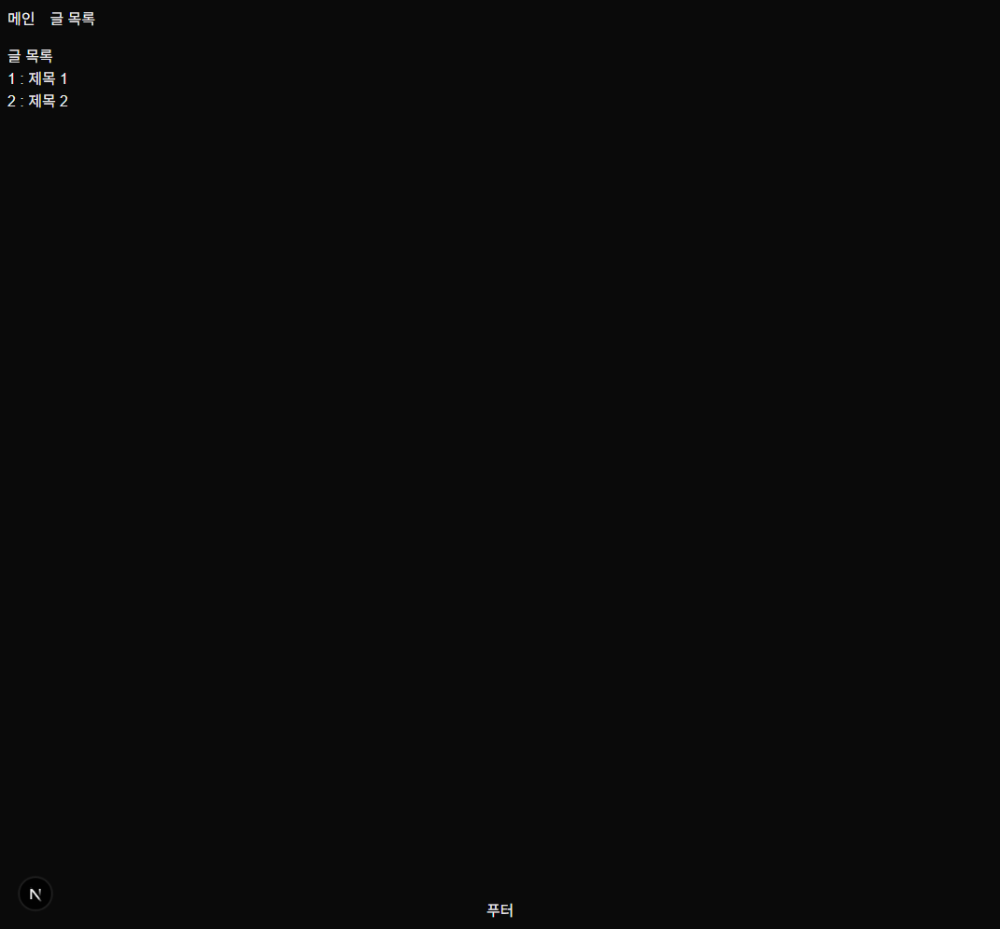 |
| `/posts/33`에서 "삭제" 클릭 | `33번 글을 정말로 삭제하시겠습니까?` 확인 → `33번 글이 삭제되었습니다.` 확인 → `/posts`로 이동, 33번이 목록에 없음 |

4-1까지는 알림창을 닫아도 지워진 글 화면에 그대로 머물렀습니다.

**알림창** (알림창 캡처용으로 34번 글을 하나 더 만들어 삭제)

| ① 삭제 클릭 → confirm | ② 확인 → 삭제 완료 alert |
|---|---|
| 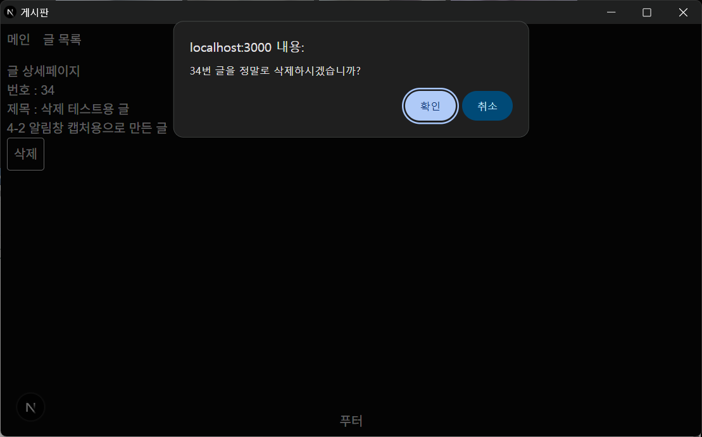 | 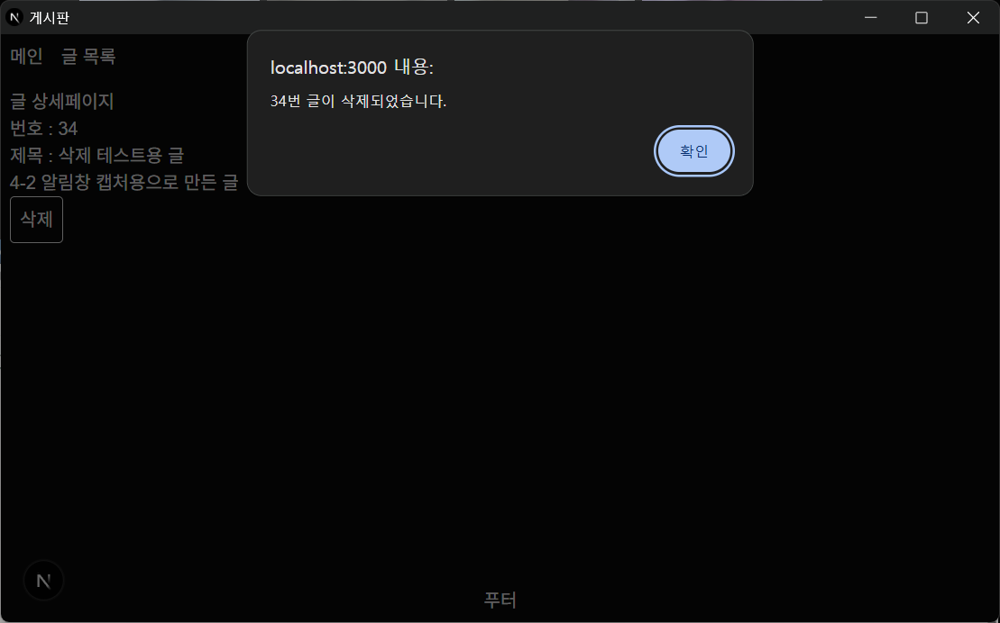 |
| 확인을 누르면 DELETE 요청, 취소면 아무 일 없음 | 확인을 누르면 `router.replace("/posts")`로 목록 이동 |

---

## 5. 글 작성

### 커밋 5-1: `/posts/write` 입력 폼 + 글 목록에 "글쓰기" 링크

**변경 파일**

| 파일 | 내용 |
|---|---|
| `src/app/posts/write/page.tsx` (새 파일) | 제목·내용 입력 폼. 저장을 누르면 입력값을 콘솔에 출력 |
| `src/app/posts/page.tsx` | 목록 아래에 `<Link href="/posts/write">글쓰기</Link>` 추가 |

**`/posts/write`와 `/posts/[id]`**

- `write`처럼 이름이 정해진 폴더가 `[id]` 같은 동적 폴더보다 **먼저** 선택됩니다. 그래서 `/posts/write`는 글쓰기 페이지, `/posts/3`은 상세 페이지로 갑니다.
- 이 커밋 전에는 `/posts/write`가 `[id]`로 처리되어 `id`가 `"write"`가 됐습니다. 그래서 `/api/v1/posts/NaN`을 요청하고 에러 알림이 떴습니다.

**폼 제출 흐름**

```
"저장" 클릭(또는 제목 칸에서 Enter) → <form>의 onSubmit 실행 → handleSubmit(e)
```

**핵심 개념**

- `<form onSubmit={handleSubmit}>`: 폼 안의 `type="submit"` 버튼을 누르거나 입력칸에서 Enter를 치면 실행됩니다. 버튼의 `onClick`이 아니라 폼의 `onSubmit`에 거는 이유는 Enter 제출까지 한 곳에서 처리하기 위해서입니다.
- `e.preventDefault()`: 폼의 기본 동작은 **페이지를 새로고침하면서** 입력값을 서버로 보내는 것입니다. 우리는 `fetch`로 직접 보낼 것이므로 이 기본 동작을 막습니다. 빠뜨리면 저장을 누르는 순간 페이지가 새로고침되어 입력값이 사라집니다.
- `e: React.SyntheticEvent<HTMLFormElement>`: 매개변수 `e`(이벤트)의 타입입니다. "폼 요소에서 일어난 React 이벤트"라는 뜻입니다.
- `e.currentTarget`: 이벤트가 걸린 요소, 즉 `<form>`입니다.
- `form.elements.namedItem("title")`: 폼 안에서 `name="title"`인 입력칸을 찾습니다.
- `as HTMLInputElement`: TypeScript에게 "이건 input 요소야"라고 알려 주는 **타입 단언**입니다. `namedItem`은 어떤 종류의 요소가 나올지 모르는 타입을 돌려주므로, 이렇게 알려 줘야 `.value`를 쓸 수 있습니다. Java의 형변환 `(HTMLInputElement) obj`와 비슷합니다.
- `maxLength={100}`: 브라우저가 100자 넘게 입력하지 못하게 막습니다.

**확인 방법**: 글 목록 → "글쓰기" → 제목·내용 입력 → 저장 → F12 Console에 입력값이 찍힘

**결과 화면**

| 전 | 후 |
|---|---|
| 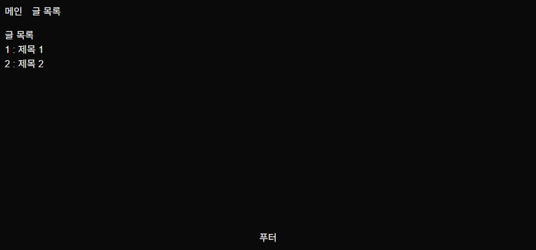 | 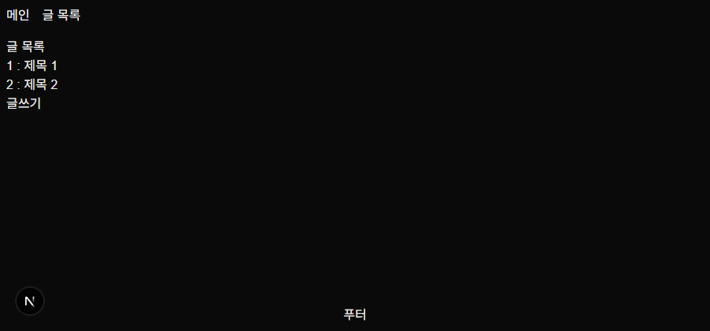 |
| `/posts` 글쓰기 링크 없음 | `/posts` 목록 아래에 "글쓰기" 링크 |
| `/posts/write`는 상세 페이지로 처리되어 에러 알림 | 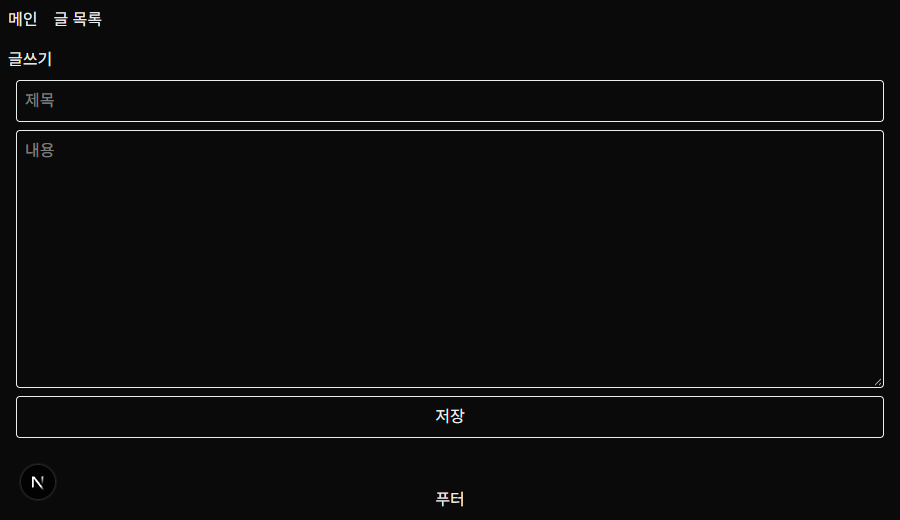 `/posts/write` 제목·내용 입력 폼 |

### 커밋 5-2: 입력값 검사 (빈 값, 2자 미만)

**변경 파일**: `src/app/posts/write/page.tsx`

백엔드에 보내기 **전에** 브라우저에서 먼저 입력값을 검사합니다. 잘못된 값이면 요청을 보내지 않고 바로 알려 줄 수 있어서 빠르고, 백엔드도 쓸데없는 요청을 받지 않습니다.

```tsx
titleInput.value = titleInput.value.trim();

if (titleInput.value.length === 0) {
  alert("제목을 입력해주세요.");
  titleInput.focus();
  return;
}

if (titleInput.value.length < 2) {
  alert("제목을 2자 이상 입력해주세요.");
  titleInput.focus();
  return;
}
// 내용(contentTextarea)도 같은 방식으로 검사
```

**핵심 개념**

- `trim()`: 앞뒤 공백을 없앱니다. `"   "`(공백만)은 `""`(빈 문자열)이 되어 "입력 안 함"으로 걸러집니다. 결과를 다시 `titleInput.value`에 넣어서 입력칸에도 정리된 값이 보이게 합니다.
- `=== 0`: JavaScript의 "같다" 비교입니다. `==`는 타입을 멋대로 바꿔 비교하므로(`0 == ""`가 true) 보통 `===`를 씁니다.
- `focus()`: 문제가 있는 입력칸으로 커서를 옮겨 바로 고쳐 쓸 수 있게 합니다.
- `return`: **조기 종료**입니다. 검사에 걸리면 함수를 바로 끝내서 아래 코드(나중에 백엔드 전송)가 실행되지 않게 합니다. Java 메서드의 `return`과 같습니다.
- 검사 순서: 제목 빈 값 → 제목 2자 미만 → 내용 빈 값 → 내용 2자 미만. 먼저 걸린 하나만 알려 줍니다.

**결과 화면** (5-1까지는 빈 값으로 저장해도 아무 반응 없이 콘솔에만 찍혔음)

| ① 아무것도 안 쓰고 저장 | ② 제목에 `a` 한 글자 |
|---|---|
|  | 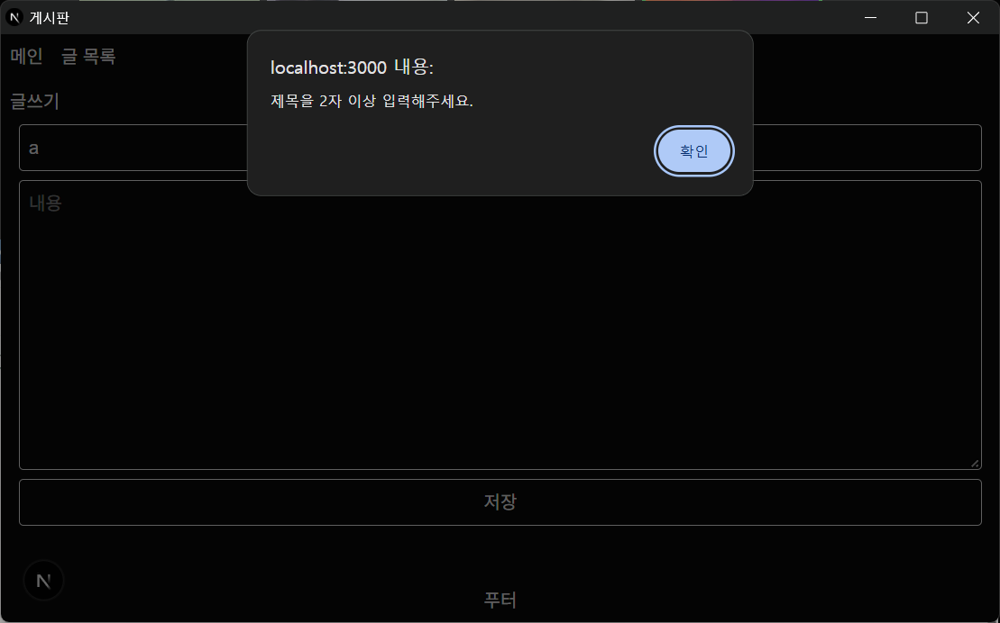 |

| ③ 제목은 OK, 내용 비움 | ④ ③에서 확인을 누른 뒤 |
|---|---|
|  | 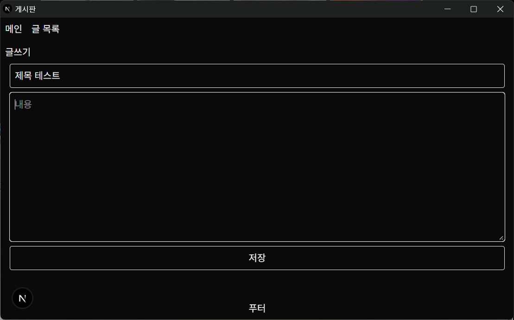 |
| | `focus()`로 내용 칸에 커서가 가 있음 |

### 커밋 5-3: POST 요청으로 글 저장 + 새 글 상세 페이지로 이동

**변경 파일**

| 파일 | 내용 |
|---|---|
| `src/lib/backend/client.ts` | 보낼 본문(`body`)이 있으면 `Content-Type: application/json` 헤더 자동 추가 |
| `src/app/posts/write/page.tsx` | 검사 통과 후 `POST /api/v1/posts` 요청, 성공하면 새 글 상세로 이동 |

**요청 보내기**

```tsx
apiFetch(`/api/v1/posts`, {
  method: "POST",
  body: JSON.stringify({
    title: titleInput.value,
    content: contentTextarea.value,
  }),
})
  .then((data) => {
    alert(data.msg);
    router.replace(`/posts/${data.data.id}`);
  })
  .catch((error) => {
    alert(`${error.resultCode} : ${error.msg}`);
  });
```

- `JSON.stringify(객체)`: 자바스크립트 객체를 JSON **문자열**로 바꿉니다. HTTP 본문에는 문자열만 실을 수 있기 때문입니다. 백엔드는 이 문자열을 `@RequestBody PostWriteReqBody`로 받아 다시 객체로 바꿉니다.
- 백엔드 응답 모양

  ```json
  { "resultCode": "201-1", "msg": "35번 글이 작성되었습니다.", "data": { "id": 35, "title": "...", ... } }
  ```

  - `data.msg`: 안내 문구
  - `data.data`: `RsData` 안의 `data` 필드 = 새로 만든 글(`PostDto`). 그래서 새 글 번호는 `data.data.id`입니다.
- `router.replace`: 4-2와 같은 이유로 `replace`를 씁니다. 저장 후 뒤로 가기를 눌렀을 때 이미 제출한 글쓰기 폼으로 돌아가지 않게 합니다.

**`apiFetch`에 헤더 자동 추가**

```ts
if (options?.body) {
  const headers = new Headers(options.headers || {});

  if (!headers.has("Content-Type")) {
    headers.set("Content-Type", "application/json; charset=utf-8");
  }

  options.headers = headers;
}
```

- `Content-Type` 헤더는 "본문이 어떤 형식인지" 알려 줍니다. 이 헤더가 없으면 스프링이 본문을 JSON으로 읽지 못해서 요청이 실패합니다(`415 Unsupported Media Type`).
- 본문을 보내는 요청(작성, 수정, 댓글 작성 등)마다 헤더를 적지 않아도 되도록 공용 함수에 넣었습니다.
- `options?.body`: `?.`는 **옵셔널 체이닝**입니다. `options`가 없으면(GET처럼 생략) 에러 없이 `undefined`가 됩니다.
- `!headers.has(...)`: 부르는 쪽에서 직접 다른 `Content-Type`을 지정했다면 덮어쓰지 않습니다.

**결과 화면** (5-2까지는 검사를 통과해도 콘솔에만 찍히고 저장되지 않았음)

| ① 제목·내용 입력 | ② 저장 → 작성 완료 alert |
|---|---|
| 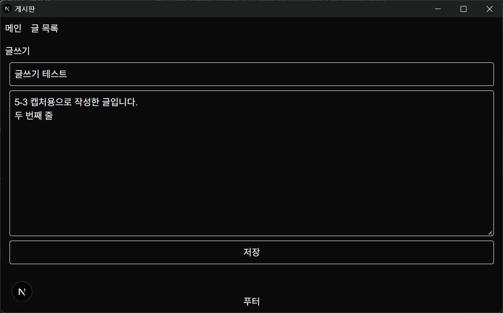 |  |

| ③ 확인 → 새 글(35번) 상세 페이지로 이동 |
|---|
| 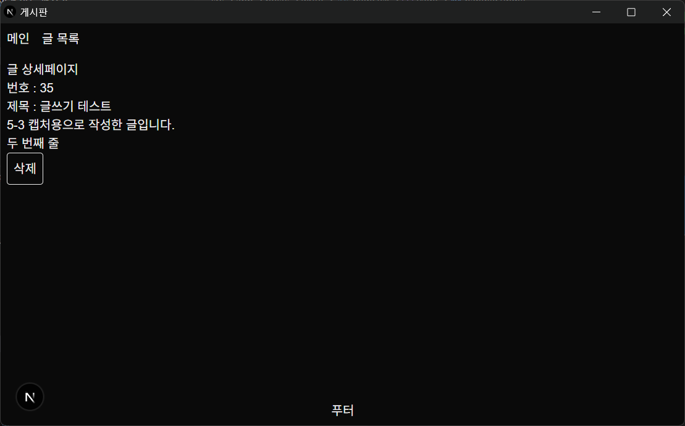 |

---

## 6. 글 수정

### 커밋 6-1: `/posts/[id]/edit` 수정 폼 (기존 글 채워 두기) + 상세에 "수정" 링크

**변경 파일**

| 파일 | 내용 |
|---|---|
| `src/app/posts/[id]/edit/page.tsx` (새 파일) | 기존 글을 불러와 입력칸에 채운 수정 폼. 저장을 누르면 콘솔에 출력 |
| `src/app/posts/[id]/edit/loading.tsx` (새 파일) | 3-1과 같은 이유(`useParams` + `cacheComponents`)로 필요 |
| `src/app/posts/[id]/page.tsx` | 삭제 버튼 옆에 `<Link href={`/posts/${post.id}/edit`}>수정</Link>` |

**폴더 구조 = 주소**

```
src/app/posts/[id]/page.tsx       → /posts/35
src/app/posts/[id]/edit/page.tsx  → /posts/35/edit
```

`edit` 폴더가 `[id]` 폴더 **안에** 있으므로 수정 페이지에서도 `useParams()`로 `id`를 꺼낼 수 있습니다.

**수정 폼 = 글쓰기 폼 + 기존 값**

- 화면 구조와 `handleSubmit`은 5-1 글쓰기와 거의 같습니다.
- 다른 점은 처음에 **기존 글을 불러와서** 입력칸에 채워 둔다는 것입니다. 불러오는 코드는 3-2 상세 페이지와 같습니다.
- `defaultValue={post.title}`: 입력칸의 **처음 값**만 정해 줍니다. 그 뒤로는 사용자가 자유롭게 고칠 수 있습니다.
  - `value={post.title}`로 쓰면 React가 값을 계속 `post.title`로 고정해서 글자를 입력해도 바뀌지 않습니다(값을 바꾸려면 `onChange`와 state가 필요).
- `if (post == null) return <div>로딩중...</div>;`가 중요합니다. `defaultValue`는 **처음 그릴 때 한 번만** 적용되므로, 글을 받아오기 전에 폼을 그려 버리면 입력칸이 빈 채로 남습니다.
- `autoFocus`: 페이지가 열리면 제목 칸에 바로 커서가 갑니다.

**확인 방법**: 글 상세 → "수정" → 기존 제목·내용이 채워진 폼 → 저장 → F12 Console에 입력값이 찍힘

**결과 화면**

| 전 | 후 |
|---|---|
| 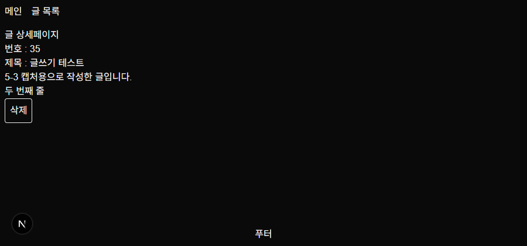 | 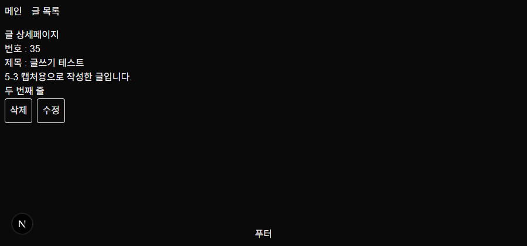 |
| `/posts/35` 수정 링크 없음 | `/posts/35` 삭제 옆에 "수정" 링크 |
|  | 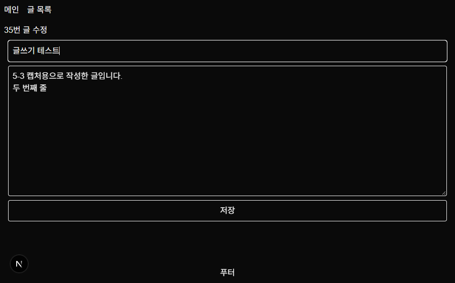 |
| `/posts/35/edit` 페이지가 없어서 404 | `/posts/35/edit` 기존 제목·내용이 채워진 수정 폼 (제목 칸에 커서) |

### 커밋 6-2: 입력 검사 + PUT 요청으로 수정 저장

**변경 파일**: `src/app/posts/[id]/edit/page.tsx`

새로 배우는 것은 거의 없고 앞에서 만든 조각을 합칩니다.

| 부분 | 어디서 배웠나 |
|---|---|
| `trim()` + 빈 값/2자 미만 검사 + `focus()` + `return` | 5-2 글쓰기 검사 (규칙도 같음) |
| `apiFetch(..., { method, body: JSON.stringify(...) })` | 5-3 글 작성 |
| 성공 시 `alert(data.msg)` 후 `router.replace(...)` | 4-2 삭제, 5-3 작성 |

**작성(POST)과 수정(PUT)의 차이**

| | 글 작성 (5-3) | 글 수정 (6-2) |
|---|---|---|
| 요청 | `POST /api/v1/posts` | `PUT /api/v1/posts/35` |
| 어떤 글? | 아직 없음 → 백엔드가 번호를 새로 정함 | 주소에 번호(`id`)를 넣어 알려 줌 |
| 응답 `data` | 새 글(`PostDto`) → `data.data.id`로 이동 | 없음(`RsData<Void>`) → 이미 아는 `id`로 이동 |

- 수정 응답에는 글 데이터가 없습니다(`"data": null`). 그래서 이동할 주소는 응답이 아니라 페이지가 이미 알고 있는 `id`(주소에서 꺼낸 값)로 만듭니다.

**결과 화면** (35번 글 수정. 6-1까지는 저장을 눌러도 콘솔에만 찍히고 바뀌지 않았음)

| ① 제목을 지우고 저장 → 검사 | ② 제목·내용 수정 |
|---|---|
| 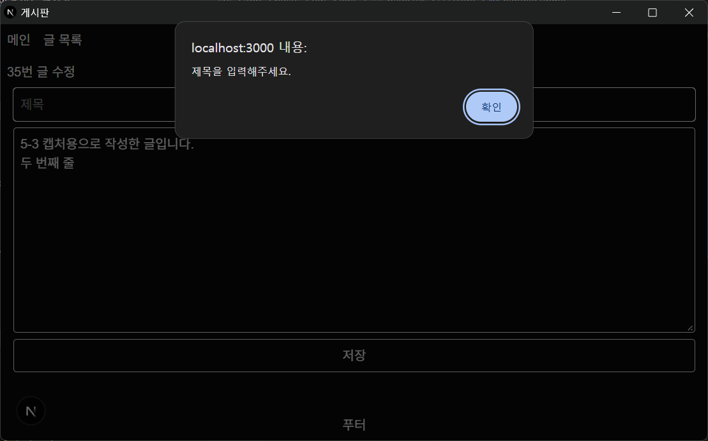 | 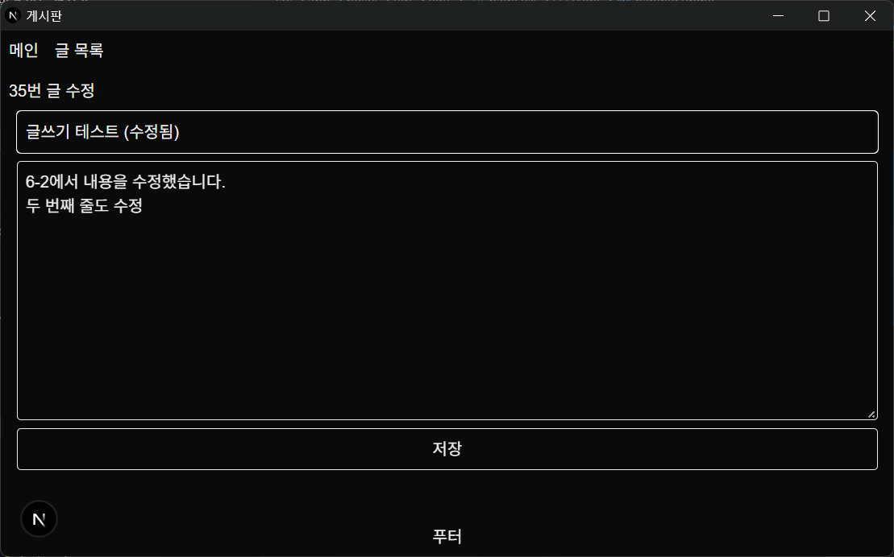 |

| ③ 저장 → 수정 완료 alert | ④ 확인 → 상세 페이지에 바뀐 내용 |
|---|---|
| 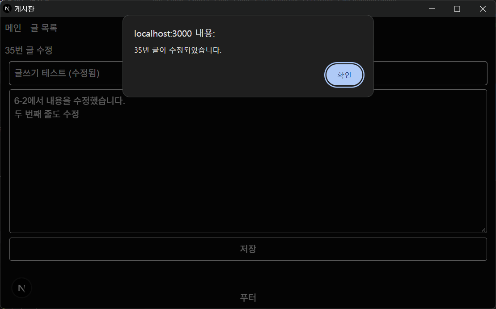 | 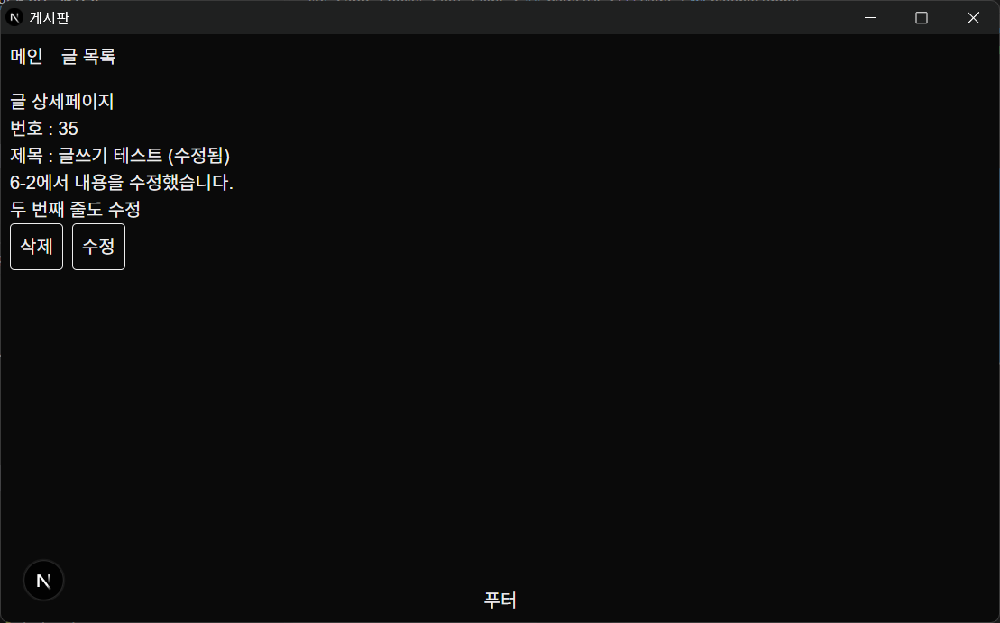 |

---

## 7. 댓글 다건조회

### 커밋 7-1: 상세 페이지 아래에 댓글 목록 출력

**변경 파일**

| 파일 | 내용 |
|---|---|
| `src/type/post.ts` | `PostCommentDto` 타입 추가 (백엔드 Java record와 같은 모양) |
| `src/app/posts/[id]/page.tsx` | 댓글 state + `useEffect`로 `GET /api/v1/posts/{id}/comments`, 목록 출력 |

**같은 패턴의 반복**

댓글 목록을 받아오는 코드는 2-2 글 목록, 3-2 글 상세와 **똑같은 패턴**입니다.

```tsx
const [postComments, setPostComments] = useState<PostCommentDto[] | null>(null);

useEffect(() => {
  apiFetch(`/api/v1/posts/${id}/comments`)
    .then(setPostComments)
    .catch(...);
}, [id]);
```

- 한 컴포넌트에 `useState`와 `useEffect`를 **여러 개** 써도 됩니다. 글(`post`)과 댓글(`postComments`)을 각각 따로 받아오고, 각자 도착하는 대로 화면에 반영됩니다.
- 그래서 화면에 "댓글 로딩중..."을 따로 두었습니다. 글이 먼저 와도 댓글은 아직일 수 있기 때문입니다.

**훅의 규칙: 조기 `return`보다 위에**

```tsx
const [post, setPost] = useState(...);          // 훅
useEffect(...);                                 // 훅
const [postComments, ...] = useState(...);      // 훅
useEffect(...);                                 // 훅

if (post == null) return <div>로딩중...</div>;  // 조기 return은 훅들 아래
```

- React는 `useState`, `useEffect` 같은 훅을 **호출 순서**로 구분합니다(첫 번째 useState, 두 번째 useState, ...).
- 훅을 `if (post == null) return` **아래**에 두면, 처음(로딩 중)에는 그 훅이 호출되지 않고 다음 번에는 호출됩니다. 순서가 바뀌어 React가 어느 state가 어느 것인지 헷갈리므로 에러가 납니다.
- 규칙: **훅은 항상 컴포넌트 맨 위에서, 조건 없이** 호출합니다.

**화면**

- `<hr>`: 가로 구분선. `my-2`는 위아래 여백
- `{" "}`: JSX에서 줄이 바뀌면 공백이 사라지므로, 공백 한 칸을 명시적으로 넣은 것입니다.

**결과 화면** (1번 글: 기본 데이터에 댓글 3개)

| 전 | 후 |
|---|---|
| 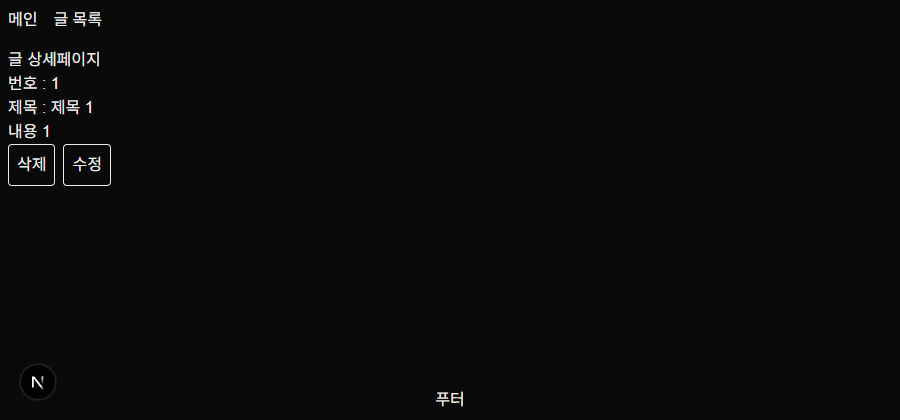 |  |
| 글 내용만 있음 | 아래에 "1번 글에 대한 댓글 목록"과 댓글 3개 |

### 커밋 7-2: 커스텀 훅 `usePost`, `usePostComments`로 분리 (리팩터링)

**변경 파일**: `src/app/posts/[id]/page.tsx`

`Page()` 하나에 글 불러오기, 글 삭제, 댓글 불러오기가 모두 들어 있어 길어졌습니다. 관련 있는 것끼리 **커스텀 훅**으로 묶었습니다.

| 커스텀 훅 | 안에 든 것 | 돌려주는 것 |
|---|---|---|
| `usePost(id)` | 글 state, 불러오기 `useEffect`, 삭제 요청 | `{ post, deletePost }` |
| `usePostComments(postId)` | 댓글 state, 불러오기 `useEffect` | `{ postComments }` |

```tsx
const { post, deletePost: _deletePost } = usePost(id);
const { postComments } = usePostComments(id);
```

**커스텀 훅이란?**

- 이름이 `use`로 시작하고, 안에서 `useState`·`useEffect` 같은 훅을 쓰는 **평범한 함수**입니다.
- "state + 그 state를 다루는 코드"를 한 덩어리로 묶어 이름을 붙이는 것입니다. 스프링에서 관련 로직을 서비스 클래스로 빼는 것과 비슷합니다.
- 커스텀 훅도 훅이므로 7-1의 규칙이 그대로 적용됩니다. 조기 `return`보다 **위에서** 호출합니다.
- `{ deletePost: _deletePost }`: 구조 분해하면서 이름을 `_deletePost`로 바꿉니다. 페이지 안에 같은 이름의 `deletePost`(버튼용)를 따로 만들기 위해서입니다.

**역할 나누기: 훅은 "데이터", 페이지는 "화면 반응"**

```tsx
// usePost 안: 요청만 하고, 성공 후 할 일은 받아서 실행
const deletePost = (onSuccess) => {
  apiFetch(`/api/v1/posts/${id}`, { method: "DELETE" }).then(onSuccess)...
};

// 페이지 안: 확인 창, 알림, 이동처럼 화면에 관한 것
const deletePost = () => {
  if (!confirm(...)) return;
  _deletePost((data) => {
    alert(data.msg);
    router.replace("/posts");
  });
};
```

- `onSuccess`처럼 **함수를 인자로 넘겨** "끝나면 이걸 해 줘"라고 맡기는 것을 **콜백**이라고 합니다.
- 덕분에 `usePost`는 "삭제 요청"만 알고, 삭제 후 목록으로 갈지 홈으로 갈지는 쓰는 쪽이 정합니다.
- `(data: { msg: string }) => void`: "msg 문자열을 가진 객체를 받아서 아무것도 돌려주지 않는 함수"라는 타입입니다.

**결과 화면**: 동작은 그대로이고 구조만 바꿨으므로 화면이 같습니다.

| 전 | 후 |
|---|---|
|  | 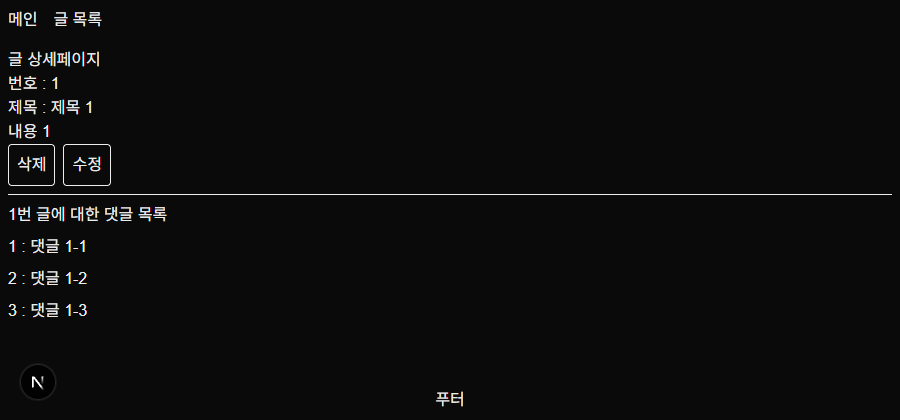 |

---

## 8. 댓글 삭제

### 커밋 8-1: 댓글마다 삭제 버튼, 삭제 후 목록에서 바로 빼기

**변경 파일**: `src/app/posts/[id]/page.tsx`

| 위치 | 추가한 것 |
|---|---|
| `usePostComments` 훅 | `deleteComment(commentId, onSuccess)`: DELETE 요청 → 성공하면 state에서 그 댓글 제거 |
| `Page` | `deleteComment(commentId)`: confirm → 훅 호출 → 성공하면 alert |
| 댓글 `<li>` | 댓글마다 "삭제" 버튼 |

**글 삭제(4-2)와 다른 점: 페이지 이동 없이 화면 갱신**

글을 지우면 그 페이지 자체가 의미가 없어져서 목록으로 이동했습니다. 댓글은 지워도 **같은 페이지에 머물러야** 하므로, 화면의 댓글 목록(state)에서 지운 댓글만 빼서 다시 그리게 합니다.

```tsx
setPostComments(postComments.filter((c) => c.id != commentId));
```

- `filter(조건)`: 배열에서 조건이 `true`인 것만 남긴 **새 배열**을 만듭니다. "id가 지운 댓글과 다른 것만 남겨라" → 지운 댓글만 빠집니다. Java Stream의 `filter`와 같습니다.
- `setPostComments(새 배열)` → React가 화면을 다시 그림 → 그 댓글이 목록에서 사라짐
- 백엔드에 목록을 다시 요청하지 않습니다. 삭제가 성공했다는 응답을 받았으니 화면 쪽 데이터만 맞춰 주면 됩니다.

**state는 직접 고치지 않고 "새 값"으로 바꾼다**

- `postComments.splice(...)`처럼 기존 배열을 직접 고치면, React는 "같은 배열"이라고 보고 화면을 다시 그리지 않을 수 있습니다.
- `filter`는 원래 배열을 건드리지 않고 새 배열을 돌려주므로 React가 변화를 알아챕니다.

**버튼에 인자 넘기기**

```tsx
<button onClick={() => deleteComment(comment.id)}>삭제</button>
```

- 4-1에서 본 것처럼 `onClick={deleteComment(comment.id)}`라고 쓰면 화면을 그릴 때 바로 실행됩니다.
- 인자가 필요할 때는 화살표 함수로 감싸서 "누르면 이걸 실행해"라는 **함수**를 넘깁니다.

**결과 화면** (35번 글에 테스트용 댓글 A(33번), B(34번)를 API로 만들어 A를 삭제)

| 전 | 후 |
|---|---|
| 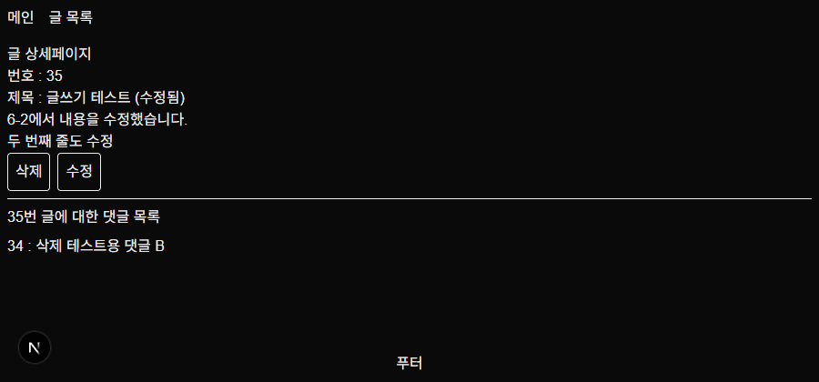 | 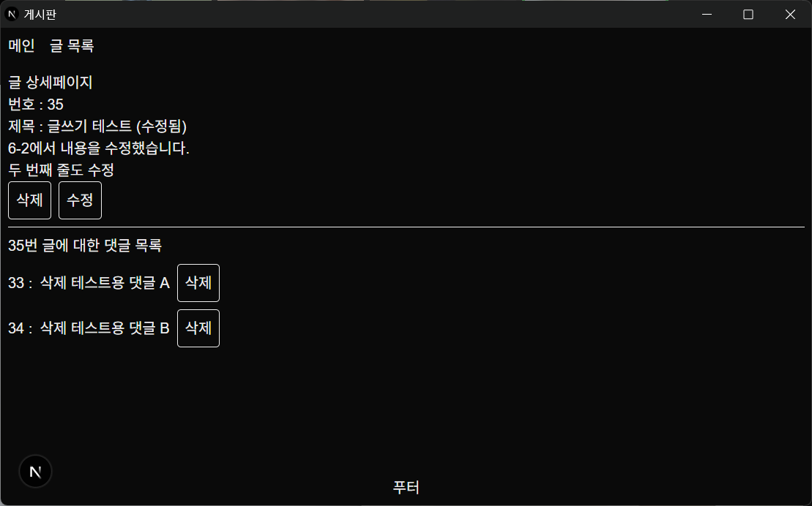 |
| 댓글에 삭제 버튼 없음 | 댓글마다 "삭제" 버튼 |

| ① A의 삭제 클릭 → confirm | ② 확인 → 삭제 완료 alert | ③ 확인 → 같은 페이지에서 A만 사라짐 |
|---|---|---|
| 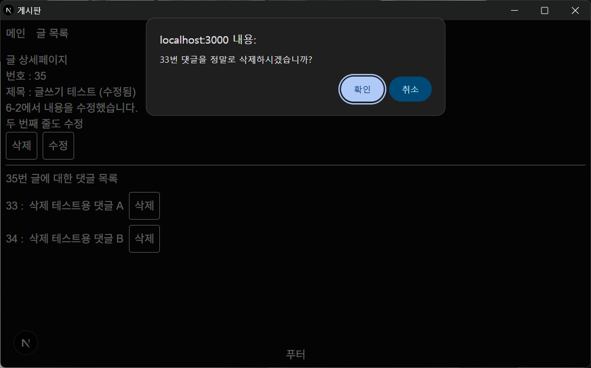 | 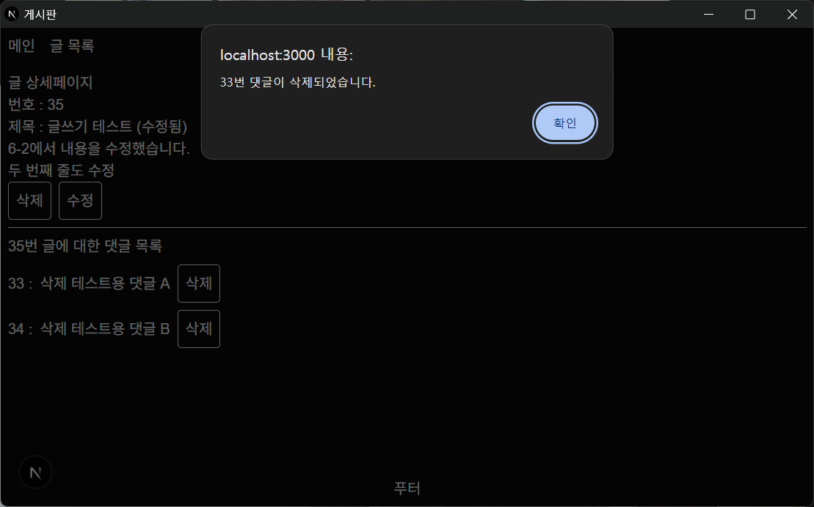 | 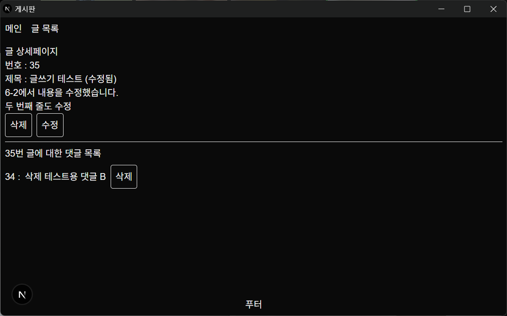 |

---

## 9. 댓글 작성

### 커밋 9-1: 댓글 입력 폼 + 입력 검사

**변경 파일**: `src/app/posts/[id]/page.tsx`

- 글 내용과 댓글 목록 사이에 "N번 글에 대한 댓글 작성" 폼을 넣었습니다.
- 새로운 개념은 없습니다. **5-1(폼 제출) + 5-2(입력 검사)** 를 댓글용으로 옮긴 것입니다.

| 단계 | 코드 | 처음 나온 곳 |
|---|---|---|
| 폼 제출 받기 | `<form onSubmit={handleCommentWriteFormSubmit}>` | 5-1 |
| 새로고침 막기 | `e.preventDefault()` | 5-1 |
| 입력칸 찾기 | `form.elements.namedItem("content") as HTMLTextAreaElement` | 5-1 |
| 검사 | `trim()` → 빈 값 → 2자 미만, `alert` + `focus()` + `return` | 5-2 |

- 백엔드 댓글 작성 API의 제약(`@NotBlank`, `@Size(min = 2, max = 100)`)에 맞춰 2자 미만을 막고, `maxLength={100}`으로 100자 넘게 입력하지 못하게 했습니다.
- 검사를 통과하면 아직은 콘솔에만 찍습니다. 백엔드 전송은 9-2에서 합니다.

**결과 화면** (35번 글)

| 전 | 후 |
|---|---|
|  | 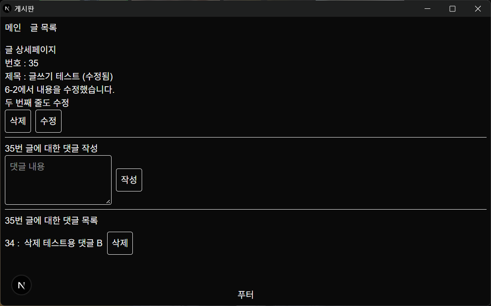 |
| 댓글 목록만 있음 | 댓글 작성 폼이 생김 |

| ① 비운 채 작성 | ② `a` 한 글자로 작성 |
|---|---|
| 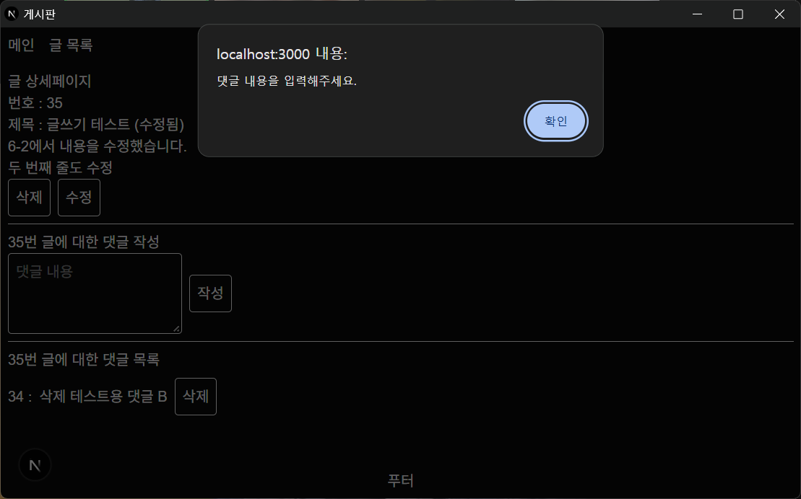 | 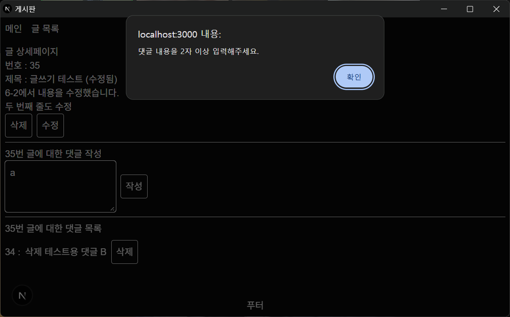 |

### 커밋 9-2: POST로 댓글 저장, 새 댓글을 목록 끝에 추가

**변경 파일**: `src/app/posts/[id]/page.tsx`

| 위치 | 추가한 것 |
|---|---|
| `usePostComments` 훅 | `writeComment(content, onSuccess)`: POST 요청 → 성공하면 새 댓글을 state 끝에 추가 |
| `Page` | 검사 통과 후 `writeComment` 호출 → 성공하면 alert + 입력칸 비우기 |

```tsx
apiFetch(`/api/v1/posts/${postId}/comments`, {
  method: "POST",
  body: JSON.stringify({ content }),
}).then((data) => {
  setPostComments([...postComments, data.data]);
  onSuccess(data);
});
```

**`[...postComments, data.data]`: 전개 문법**

- `...배열`은 배열 안의 요소들을 그 자리에 **펼쳐 놓습니다**. `[...[a, b], c]` → `[a, b, c]`
- 기존 댓글들을 펼쳐 넣고 끝에 새 댓글을 붙인 **새 배열**을 만듭니다.
- 8-1의 `filter`와 같은 원칙입니다. 기존 배열을 `push`로 직접 고치지 않고 새 배열로 바꿔야 React가 변화를 알아채고 다시 그립니다.

| | 8-1 댓글 삭제 | 9-2 댓글 작성 |
|---|---|---|
| state 바꾸기 | `postComments.filter(c => c.id != commentId)` | `[...postComments, data.data]` |
| 결과 | 그 댓글만 뺀 새 배열 | 끝에 새 댓글을 더한 새 배열 |

- `data.data`: 백엔드 응답(`RsData<PostCommentDto>`)의 `data` = 방금 저장된 댓글(번호, 날짜 포함). 5-3에서 새 글 번호를 `data.data.id`로 꺼낸 것과 같은 구조입니다.
- `{ content }`: `{ content: content }`의 줄임 표기입니다. 변수 이름과 키 이름이 같으면 한 번만 씁니다.
- `contentTextarea.value = ""`: 저장 후 입력칸을 비워 다음 댓글을 바로 쓸 수 있게 합니다.

**결과 화면** (35번 글에 댓글 작성. 9-1까지는 검사를 통과해도 콘솔에만 찍혔음)

| ① 댓글 입력 | ② 작성 → 완료 alert | ③ 확인 → 목록 끝에 35번 댓글, 입력칸 비워짐 |
|---|---|---|
| 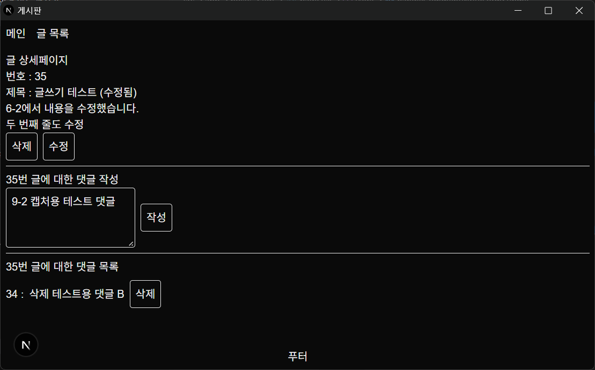 | 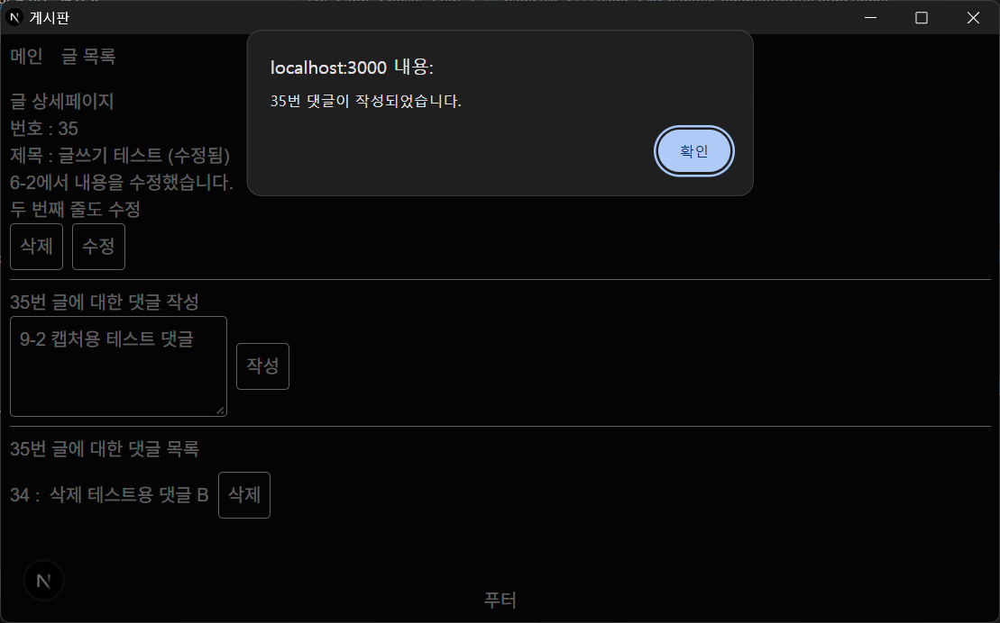 | 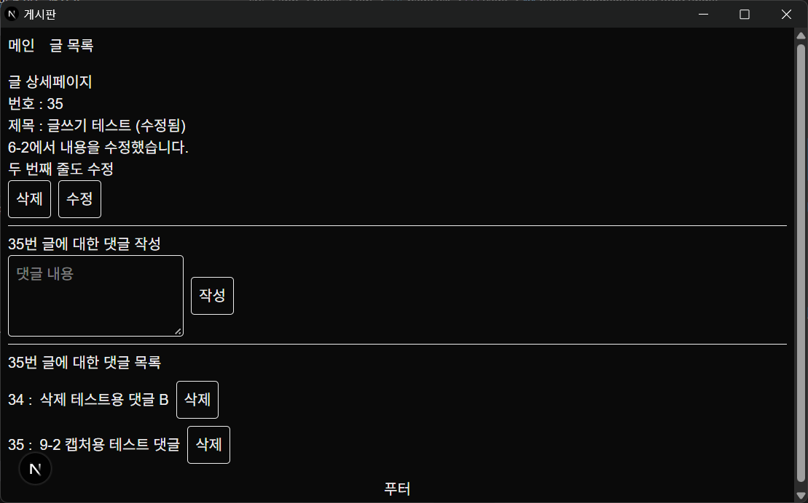 |

---

## 10. 리팩토링

9-2까지 `src/app/posts/[id]/page.tsx`의 `Page()` 하나가 글 정보, 댓글 작성 폼, 댓글 목록을 모두 그렸습니다. 기능은 그대로 두고 **화면 조각마다 컴포넌트로 나눕니다**.

> 강의(45강)에서도 말하듯 컴포넌트 구조화는 필수가 아닙니다. 다만 파일이 길어질수록 "이 화면 조각은 어디서 그리지?"를 찾기 쉬워집니다.

### 커밋 10-1: `PostInfo`, `PostCommentWriteAndList` 컴포넌트로 분리 (37강)

**변경 파일**: `src/app/posts/[id]/page.tsx`

| 컴포넌트 | 그리는 것 | 부모에게 받는 값(props) |
|---|---|---|
| `PostInfo` | 번호, 제목, 내용, 삭제/수정 버튼 | `post`, `deletePost` |
| `PostCommentWriteAndList` | 댓글 작성 폼 + 댓글 목록 | `id`, `postComments`, `deleteComment`, `writeComment` |
| `Page` | 위 두 컴포넌트를 배치 | (주소에서 `id`를 읽고 훅을 호출) |

```tsx
// Page의 return이 이만큼 짧아졌다
<h1>글 상세페이지</h1>

<PostInfo post={post} deletePost={deletePost} />

<hr className="my-2" />

<PostCommentWriteAndList
  id={id}
  postComments={postComments}
  deleteComment={deleteComment}
  writeComment={writeComment}
/>
```

**컴포넌트와 props**

- 컴포넌트는 **JSX를 돌려주는 함수**입니다. `Page`도 컴포넌트입니다. 이름은 대문자로 시작해야 `<PostInfo />`처럼 태그로 쓸 수 있습니다.
- `<PostInfo post={post} />`처럼 태그에 붙인 값들은 **객체 하나**로 묶여 함수의 첫 번째 인자로 들어옵니다. 이것을 **props**라고 합니다.
- 받는 쪽에서는 구조 분해로 꺼냅니다. 콜론 뒤는 그 객체의 타입입니다.

```tsx
function PostInfo({
  post,          // props.post
  deletePost,    // props.deletePost
}: {
  post: PostDto;
  deletePost: () => void;   // 인자 없이 호출하고 돌려주는 값이 없는 함수
}) { ... }
```

- 스프링에 비유하면 메서드에 매개변수를 넘기는 것과 같습니다. 하위 컴포넌트는 부모의 변수를 직접 볼 수 없으므로 필요한 것을 **모두 props로 받아야** 합니다.
- `handleCommentWriteFormSubmit`(댓글 작성 폼 제출 처리)은 그 폼을 그리는 `PostCommentWriteAndList` 안으로 옮겼습니다. 확인창이 있는 `deletePost`, `deleteComment`는 아직 `Page`에 남아 있습니다(10-3에서 옮김).

#### 코드 상세 설명

> 줄 번호는 **10-1 커밋(`a90115e`) 시점의 `src/app/posts/[id]/page.tsx`** 기준입니다. 설명 앞의 **[숫자]** 가 그 설명이 가리키는 코드 줄입니다.
> 지금 파일은 다음 커밋들 때문에 줄 번호가 다릅니다. 이 시점 파일은 `git show a90115e:"src/app/posts/[id]/page.tsx"`로 볼 수 있습니다.

**파일 지도**

| 줄 | 무엇 | 10-1에서 |
|---|---|---|
| 1~7 | `"use client"`, import | 변화 없음 |
| 10~34 | 훅 `usePost` | 변화 없음 |
| 37~94 | 훅 `usePostComments` | 변화 없음 |
| 96~121 | 컴포넌트 `PostInfo` | **새로 생김** |
| 123~220 | 컴포넌트 `PostCommentWriteAndList` | **새로 생김** |
| 222~280 | `Page` | **return이 짧아짐** |

**① `Page`: 데이터를 준비하고 화면 조각을 배치 (222~280번 줄)**

```tsx
227  const { id: idStr } = useParams<{ id: string }>();
228  const id = Number(idStr);
```

- **[222]** `/posts/35`로 접속하면 Next.js가 이 파일의 `export default` 함수 `Page`를 실행합니다. 나머지 컴포넌트는 `Page`가 가져다 쓰는 부품입니다.
- **[227]** 폴더 이름이 `[id]`이므로 `/posts/35`의 `35`가 `id`라는 이름으로 들어옵니다. 주소에서 꺼낸 값은 항상 **문자열**입니다.
- **[227]** `{ id: idStr }`: 구조 분해하면서 이름을 `idStr`로 바꿉니다. `id`라는 이름은 숫자용으로 쓰기 위해서입니다.
- **[228]** `Number("35")` → `35`. 백엔드 주소를 만들 때 숫자가 필요합니다.

```tsx
231  const { post, deletePost: _deletePost } = usePost(id);
232  const {
233    postComments,
234    deleteComment: _deleteComment,
235    writeComment,
236  } = usePostComments(id);
```

- **[231]** `usePost`가 돌려준 `{ post, deletePost }`(훅의 33번 줄)에서 두 값을 꺼냅니다. `post`는 처음엔 `null`이고, 응답이 와서 `setPost`가 호출되면 React가 `Page`를 **처음부터 다시 실행**합니다.
- **[231]** `deletePost: _deletePost`: 이름을 바꿔서 꺼냅니다. 241번 줄에서 확인창이 붙은 같은 이름의 함수를 새로 만들기 때문입니다.
- **[232~236]** `usePostComments`가 돌려준 객체(훅의 93번 줄)에서 세 값을 꺼냅니다. **[234]** `deleteComment`도 254번 줄 때문에 `_deleteComment`로 이름을 바꿉니다.
- **[231~236]** 훅은 238번 줄의 조기 `return`보다 **위에서** 호출합니다. React는 매번 같은 순서로 훅이 호출된다고 가정하고 state를 기억하기 때문입니다(7-1).

```tsx
238  if (post == null) return <div>로딩중...</div>;
```

- **[238]** 응답 전에는 로딩 표시만 그리고 끝냅니다. 이 줄 아래에서는 TypeScript도 `post`가 `null`이 아님을 알아서 243번 줄의 `post.id`를 쓸 수 있습니다.

```tsx
241  const deletePost = () => {
243    if (!confirm(`${post.id}번 글을 정말로 삭제하시겠습니까?`)) return;
245    _deletePost((data) => {
246      alert(data.msg);
249      router.replace("/posts");
250    });
251  };
```

- **[241]** 함수를 **만들어 두기만** 합니다. 실행은 `PostInfo`의 112번 줄 버튼을 누를 때입니다.
- **[243]** 확인창. 취소를 누르면 `confirm`이 `false` → `return`으로 끝납니다.
- **[245]** 231번 줄에서 꺼낸 훅 함수(DELETE 요청, **데이터** 일)를 호출하며 콜백을 넘깁니다.
- **[246, 249]** 콜백 안: 알림을 띄우고 목록으로 이동합니다(**화면 반응** 일). 249번 줄의 `router`는 224번 줄에서 가져온 것입니다.
- **[254~261]** `deleteComment`도 같은 구조입니다. 다만 이동 없이 알림만 띄웁니다. 목록에서 댓글이 빠지는 것은 훅(62번 줄)이 `filter`로 state를 바꿔서 처리합니다(8-1).

```tsx
268      <PostInfo post={post} deletePost={deletePost} />
272      <PostCommentWriteAndList
273        id={id}
274        postComments={postComments}
275        deleteComment={deleteComment}
276        writeComment={writeComment}
277      />
```

- **[268]** 태그처럼 보이지만 실제로는 `PostInfo({ post: post, deletePost: deletePost })`처럼 98번 줄의 **함수를 호출**하는 것입니다. 태그에 붙인 값들이 객체 하나(props)로 묶여 넘어갑니다.
- **[268]** `post={post}`에서 왼쪽은 **받는 쪽이 쓸 이름**(99번 줄), 오른쪽 `{post}`는 **`Page`의 변수 값**(231번 줄)입니다.
- **[268]** `deletePost={deletePost}`: 241번 줄 함수를 넘깁니다. `deletePost()`처럼 괄호를 붙이면 그 자리에서 실행되어 버립니다.
- **[273~276]** 124번 줄 `PostCommentWriteAndList`에 네 값을 넘깁니다. 273번 줄은 228번 줄의 `id`, 274·276번 줄은 233·235번 줄의 훅 값, 275번 줄은 254번 줄에서 만든 함수입니다.

**② `PostInfo`: 글 정보와 버튼 (98~121번 줄)**

```tsx
 98  function PostInfo({
 99    post,
100    deletePost,
101  }: {
102    post: PostDto;
103    deletePost: () => void;
104  }) {
```

- **[99~100]** props 구조 분해. `Page` 268번 줄에서 붙인 `post`, `deletePost`를 같은 이름으로 꺼냅니다.
- **[101~104]** 콜론 뒤는 props 객체의 **타입**입니다.
- **[102]** `post`가 `PostDto | null`이 아닌 이유: `Page`가 238번 줄에서 `null`을 걸러낸 뒤에만 이 컴포넌트를 그리기 때문입니다.
- **[103]** `() => void`: 인자 없이 호출하고 아무것도 돌려주지 않는 함수. `Page` 241번 줄 함수의 모양입니다.
- **[101~104]** 타입 덕분에 268번 줄에서 `deletePost`를 빠뜨리면 TypeScript가 바로 오류를 냅니다.

```tsx
107      <div>번호 : {post.id}</div>
108      <div>제목 : {post.title}</div>
109      <div style={{ whiteSpace: "pre-line" }}>{post.content}</div>
112        <button ... onClick={deletePost}>
115        <Link ... href={`/posts/${post.id}/edit`}>
```

- **[107~108]** JSX의 `{ }` 안에는 자바스크립트 값을 넣습니다. `{post.id}`는 `35`로 바뀌어 나옵니다.
- **[109]** `whiteSpace: "pre-line"`: 내용 속 줄바꿈(`\n`)을 화면에서도 줄바꿈으로 보여 줍니다.
- **[112]** `onClick={deletePost}`: 클릭되면 100번 줄에서 받은 함수, 즉 `Page` 241번 줄 함수를 실행합니다. `PostInfo`는 삭제 방법을 모르고 **버튼이 눌렸다는 사실만 전달**합니다.
- **[115]** `Link`: 새로고침 없이 `/posts/35/edit`로 이동합니다(1-1).
- **[106, 119]** `<> ... </>`(Fragment): 컴포넌트는 덩어리 하나만 `return`할 수 있어서, 화면에 태그를 남기지 않고 여러 요소를 묶습니다.

**③ `PostCommentWriteAndList`: 댓글 작성 폼 + 목록 (124~220번 줄)**

```tsx
124  function PostCommentWriteAndList({
125    id,
126    postComments,
127    deleteComment,
128    writeComment,
129  }: {
130    id: number;
131    postComments: PostCommentDto[] | null;
132    deleteComment: (commentId: number) => void;
133    writeComment: (
134      content: string,
135      onSuccess: (data: { msg: string }) => void,
136    ) => void;
137  }) {
```

| 줄 | prop | 타입 | 어디서 왔나 |
|---|---|---|---|
| 125, 130 | `id` | `number` | `Page` 273번 줄 ← 228번 줄 |
| 126, 131 | `postComments` | `PostCommentDto[] \| null` | `Page` 274번 줄 ← 훅의 state |
| 127, 132 | `deleteComment` | `(commentId: number) => void` | `Page` 275번 줄 ← 254번 줄 "확인창 + 삭제" 함수 |
| 128, 133~136 | `writeComment` | `(content, onSuccess) => void` | `Page` 276번 줄 ← 훅의 72번 줄 함수 **그대로** |

- **[131]** `postComments`에만 `| null`이 붙는 이유: `Page`는 238번 줄에서 글만 기다리고 댓글은 기다리지 않으므로, 댓글이 오기 전에 이 컴포넌트가 그려질 수 있습니다.
- **[133~136]** 훅 72~75번 줄의 인자 모양과 똑같이 적어야 합니다. 이 중복을 10-3에서 없앱니다.

```tsx
139  const handleCommentWriteFormSubmit = (
140    e: React.SyntheticEvent<HTMLFormElement>,
141  ) => {
142    e.preventDefault();
144    const form = e.currentTarget;
146    const contentTextarea = form.elements.namedItem(
147      "content",
148    ) as HTMLTextAreaElement;
150    contentTextarea.value = contentTextarea.value.trim();
152    if (contentTextarea.value.length === 0) { ... return; }
158    if (contentTextarea.value.length < 2) { ... return; }
164    writeComment(contentTextarea.value, (data) => {
165      alert(data.msg);
168      contentTextarea.value = "";
169    });
170  };
```

- **[139]** `Page`에서 옮겨 온 함수입니다. 178번 줄 폼의 `onSubmit`에 등록되어 있어서 폼이 제출되면 실행됩니다.
- **[142]** 폼 기본 동작(새로고침하며 전송)을 막습니다.
- **[144]** `e.currentTarget`: 이벤트가 걸린 `<form>`(176번 줄)입니다.
- **[146~148]** `name="content"`인 입력칸(182번 줄)을 찾습니다. **두 이름이 맞아야** 합니다. `as HTMLTextAreaElement`로 textarea라고 알려 줘야 `.value`, `.focus()`를 쓸 수 있습니다.
- **[150]** 앞뒤 공백을 지운 값을 입력칸에 다시 넣습니다.
- **[152~156]** 빈 값이면 `alert` + `focus()` + `return`으로 멈춥니다.
- **[158~162]** 2자 미만이면 멈춥니다. 백엔드 `@Size(min = 2)`와 같은 기준입니다.
- **[164]** 128번 줄에서 받은 `writeComment`(실체는 훅의 72번 줄)를 호출합니다. 훅이 POST를 보내고 → 84번 줄에서 목록 끝에 새 댓글을 붙인 뒤 → 86번 줄에서 이 콜백을 실행합니다.
- **[165, 168]** 콜백: 알림을 띄우고 입력칸을 비웁니다.
- **[139~170]** 옮긴 이유: 이 컴포넌트의 폼에서만 쓰기 때문입니다. 쓰는 곳 가까이 두면 폼을 고칠 때 한 컴포넌트만 보면 됩니다.

```tsx
174      <h2>{id}번 글에 대한 댓글 작성</h2>
176      <form
177        className="flex gap-2 items-center"
178        onSubmit={handleCommentWriteFormSubmit}
182          name="content"
184          maxLength={100}
187        <button ... type="submit">
```

- **[174]** 125번 줄에서 받은 `id`를 씁니다. 이 값이 필요해서 `id`를 props로 받았습니다.
- **[176~178]** 폼이 제출되면 139번 줄 함수를 실행합니다. `flex`는 가로 배치, `gap-2`는 간격, `items-center`는 세로 가운데 정렬입니다.
- **[182]** 146~148번 줄의 `namedItem("content")`가 이 이름으로 찾습니다.
- **[184]** 100자를 넘게 입력하지 못하게 합니다.
- **[187]** `type="submit"` 버튼을 누르면 폼이 제출되고 → 178번 줄 `onSubmit` → 139번 줄 함수가 실행됩니다.

```tsx
196      {postComments == null && <div>댓글 로딩중...</div>}
198      {postComments != null && postComments.length == 0 && (
202      {postComments != null && postComments.length > 0 && (
204          {postComments.map((comment) => (
205            <li key={comment.id} className="flex gap-2 items-center">
207              <span style={{ whiteSpace: "pre-line" }}>{comment.content}</span>
210                onClick={() => deleteComment(comment.id)}
```

- **[196, 198, 202]** `조건 && <JSX>`: 조건이 참일 때만 그립니다. 세 조건 중 정확히 하나만 참입니다.

| 줄 | 상태 | 화면 |
|---|---|---|
| 196 | `null` (응답 전) | 댓글 로딩중... |
| 198 | 빈 배열 | 댓글이 없습니다. |
| 202 | 1개 이상 | `<ul>` 목록 |

- **[204]** `map`: 댓글 하나하나를 `<li>`로 바꾼 새 배열을 만듭니다.
- **[205]** `key`: React가 어떤 `<li>`가 어떤 댓글인지 구분하는 표식입니다. 추가·삭제 때 바뀐 줄만 다시 그립니다.
- **[210]** `onClick={() => deleteComment(comment.id)}`
  - `onClick={deleteComment}`라면 → 몇 번 댓글인지 전달할 수 없습니다.
  - `onClick={deleteComment(comment.id)}`라면 → 화면을 그리는 순간 바로 실행됩니다.
  - 그래서 "클릭되면 이 번호로 불러 줘"라는 **새 화살표 함수**로 감쌉니다. 댓글마다 하나씩 만들어지고 각자 자기 `comment.id`를 기억합니다.

**④ 버튼을 누르면 실행되는 줄 순서**

```
[글 삭제]
112 PostInfo 삭제 버튼 → 241 Page의 deletePost → 243 confirm
→ 245 _deletePost(콜백) → 훅 23~25 DELETE → 27 .then(onSuccess)
→ 246 alert → 249 router.replace("/posts")

[댓글 작성]
187 작성 버튼 → 178 onSubmit → 139 handleCommentWriteFormSubmit
→ 142 preventDefault → 150 trim → 152·158 검사
→ 164 writeComment → 훅 72~79 POST → 84 setPostComments([...기존, 새 댓글]) → 86 onSuccess
→ 165 alert → 168 입력칸 비우기
→ (84번 줄에서 state 변경) 222 Page 다시 실행 → 274 새 배열이 props로 → 204 map → 목록 갱신

[댓글 삭제]
210 () => deleteComment(34) → 254 Page의 deleteComment → confirm
→ _deleteComment(34, 콜백) → 훅 51~57 DELETE → 62 filter → 64 onSuccess → alert
→ 222 Page 다시 실행 → 274 줄어든 배열 → 204 map → 목록에서 사라짐
```

- **데이터(state)는 위(`Page`, 훅)에 있고 props를 타고 아래로 내려갑니다.**
- 하위 컴포넌트는 데이터를 직접 바꾸지 못하고, **위에서 내려 준 함수를 호출해서** 바꿔 달라고 요청합니다.
- state가 바뀌면 state를 가진 `Page`부터 다시 실행되고, 새 값이 props로 내려가 화면이 갱신됩니다.

**⑤ 9-2 → 10-1 비교**

| 코드 | 9-2 | 10-1 |
|---|---|---|
| 글 정보 JSX | `Page` 안 | `PostInfo` 105~120번 줄 |
| 댓글 작성 폼·목록 JSX | `Page` 안 | `PostCommentWriteAndList` 172~219번 줄 |
| `handleCommentWriteFormSubmit` | `Page` 안 | `PostCommentWriteAndList` 139~170번 줄 |
| `deletePost`, `deleteComment` (확인창) | `Page` 안 | `Page` 241~261번 줄 (10-2에서 이동) |
| 훅, 동작, 화면 | | 변화 없음 |

**아쉬운 점** (다음 커밋에서 개선)

- 훅이 돌려준 값을 `Page`에서 하나하나 꺼냈다가 다시 하나하나 넘깁니다. 넘길 값이 늘면 `Page`와 하위 컴포넌트를 둘 다 고쳐야 합니다.
- `writeComment`의 타입 `(content: string, onSuccess: ...) => void`를 훅과 컴포넌트 두 곳에 똑같이 적었습니다.

**결과 화면**: 구조만 바꿔서 화면이 9-2와 같으므로(`docs/images/10-1.png`), 대신 **커밋 변경점**을 캡처했습니다. 왼쪽 숫자는 9-2 줄 번호, 오른쪽 숫자는 10-1 줄 번호입니다. 빨간 줄은 지운 줄, 초록 줄은 추가한 줄입니다.

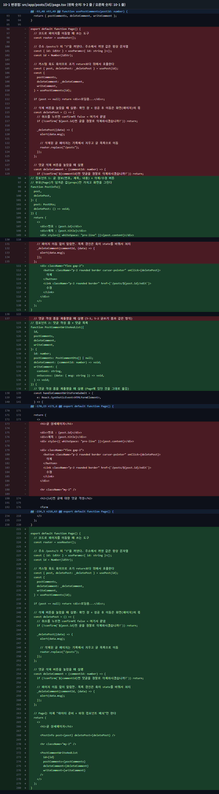

### 커밋 10-2: 확인창·알림 함수를 하위 컴포넌트 안으로 이동 (43강)

**변경 파일**: `src/app/posts/[id]/page.tsx`

> 계획에서는 41·42강(훅 결과 객체 넘기기)을 먼저 하려 했습니다. 하지만 그러려면 확인창 함수가 `Page`에 남아 있으면 안 되므로, 43강 내용을 먼저 적용했습니다.

10-1에서 확인창을 띄우는 `deletePost`, `deleteComment`는 `Page`에 있었습니다. 그런데 이 함수를 실제로 쓰는 버튼은 `PostInfo`, `PostCommentWriteAndList` 안에 있습니다. **함수를 쓰는 컴포넌트 안으로** 옮겼습니다.

| 함수 | 10-1 위치 | 10-2 위치 |
|---|---|---|
| `deletePost` (확인창 + 알림 + 목록 이동) | `Page` | `PostInfo` |
| `deleteComment` (확인창 + 알림) | `Page` | `PostCommentWriteAndList` |
| `useRouter()` | `Page` | `PostInfo` (이동이 필요한 곳) |

#### 코드 상세 설명

> 줄 번호는 **10-2 커밋 시점의 `src/app/posts/[id]/page.tsx`** 기준입니다. 설명 앞의 **[숫자]** 가 그 설명이 가리키는 코드 줄입니다. 10-1 시점 줄 번호는 "10-1의 N번 줄"이라고 따로 적었습니다.

**파일 지도**

| 줄 | 무엇 | 10-2에서 |
|---|---|---|
| 10~34 | 훅 `usePost` | 변화 없음 |
| 37~94 | 훅 `usePostComments` | 변화 없음 |
| 98~138 | 컴포넌트 `PostInfo` | **`router`, `deletePost`가 들어옴** |
| 141~250 | 컴포넌트 `PostCommentWriteAndList` | **`deleteComment`가 들어옴** |
| 252~281 | `Page` | **짧아짐** |

**① 훅이 돌려주는 함수의 모양 (변화 없음, 비교 기준)**

```tsx
 23  const deletePost = (onSuccess: (data: { msg: string }) => void) => {
 24    apiFetch(`/api/v1/posts/${id}`, {
 25      method: "DELETE",
 26    })
 27      .then(onSuccess)
 33  return { post, deletePost };
 51  const deleteComment = (
 52    commentId: number,
 53    onSuccess: (data: { msg: string }) => void,
 54  ) => {
 72  const writeComment = (
 73    content: string,
 74    onSuccess: (data: { msg: string }) => void,
 75  ) => {
 93  return { postComments, deleteComment, writeComment };
```

- **[23]** `usePost`의 `deletePost`는 **성공 콜백 하나**를 받습니다. 아래 103번 줄 타입과 모양이 같아야 합니다.
- **[24~25]** DELETE 요청을 보냅니다. **[27]** 성공하면 받은 콜백을 실행합니다. 확인창은 훅에 **없습니다**.
- **[33]** 이 객체가 `Page` 258번 줄로 갑니다.
- **[51~54]** `deleteComment`는 **댓글 번호와 성공 콜백 두 개**를 받습니다. 아래 149~152번 줄 타입과 같아야 합니다.
- **[72~75]** `writeComment`는 **내용과 성공 콜백**을 받습니다. 아래 153~156번 줄 타입과 같아야 합니다.
- **[93]** 이 객체가 `Page` 259번 줄로 갑니다.

**② `Page`: 훅이 준 것을 가공하지 않고 그대로 넘긴다 (252~281번 줄)**

```tsx
254  const { id: idStr } = useParams<{ id: string }>();
255  const id = Number(idStr);
258  const { post, deletePost } = usePost(id);
259  const { postComments, deleteComment, writeComment } = usePostComments(id);
261  if (post == null) return <div>로딩중...</div>;
269      <PostInfo post={post} deletePost={deletePost} />
273      <PostCommentWriteAndList
274        id={id}
275        postComments={postComments}
276        deleteComment={deleteComment}
277        writeComment={writeComment}
278      />
```

- **[254~255]** 주소에서 `"35"`를 꺼내 숫자 `35`로 바꿉니다(10-1과 같음).
- **[258]** 33번 줄 객체에서 `post`, `deletePost`를 꺼냅니다. **10-1의 231번 줄과 달리 이름을 바꾸지 않습니다**(`_deletePost` 없음). `Page`에서 같은 이름의 함수를 새로 만들지 않기 때문입니다.
- **[259]** 93번 줄 객체에서 세 값을 꺼냅니다. 역시 이름을 바꾸지 않습니다.
- **[261]** 글이 오기 전이면 로딩 표시만 그립니다.
- **[269]** 태그 모양은 10-1의 268번 줄과 같지만 **넘어가는 함수가 다릅니다.**
  - 10-1: 10-1의 241번 줄 "확인창 + 삭제" 함수 (인자 없음)
  - 10-2: 훅의 23번 줄 "DELETE 요청만 하는" 함수 (성공 콜백을 인자로 받음)
- **[276]** 훅의 51번 줄 함수를 그대로 넘깁니다. **[277]** 훅의 72번 줄 함수를 그대로 넘깁니다.
- `Page`에서 빠진 것: **[10-1의 224]** `useRouter()` → 106번 줄로 이동, **[10-1의 241~251]** `deletePost` → 110~120번 줄로 이동, **[10-1의 254~261]** `deleteComment` → 159~166번 줄로 이동.

**③ `PostInfo`: 훅 함수를 받아서, 확인창을 붙인 함수를 직접 만든다 (98~138번 줄)**

```tsx
 98  function PostInfo({
 99    post,
100    deletePost: _deletePost,
101  }: {
102    post: PostDto;
103    deletePost: (onSuccess: (data: { msg: string }) => void) => void;
104  }) {
106    const router = useRouter();
110    const deletePost = () => {
112      if (!confirm(`${post.id}번 글을 정말로 삭제하시겠습니까?`)) return;
114      _deletePost((data) => {
115        alert(data.msg);
118        router.replace("/posts");
119      });
120    };
129          <button className="p-2 rounded border cursor-pointer" onClick={deletePost}>
```

- **[99]** `Page` 269번 줄의 `post={post}`를 꺼냅니다.
- **[100]** **props 구조 분해에서도 이름을 바꿀 수 있습니다.** `{ deletePost: _deletePost }`는 "props의 `deletePost`를 `_deletePost` 변수로 꺼내라"는 뜻입니다. 254번 줄의 `{ id: idStr }`와 같은 문법입니다. 110번 줄에서 버튼용 `deletePost`를 만들기 위해 이름을 비워 둡니다.
- **[102]** `null`이 아닌 이유는 `Page` 261번 줄에서 이미 걸렀기 때문입니다.
- **[103]** props 타입이 10-1의 103번 줄 `() => void`에서 `(onSuccess: ...) => void`로 바뀌었습니다. 이제 훅 함수를 그대로 받으므로 **훅 23번 줄의 모양**을 그대로 적어야 합니다.
- **[106]** `useRouter()`도 훅이라서 컴포넌트 함수의 **맨 위**에서 호출합니다. `PostInfo`에는 조기 `return`이 없으니 맨 위에 두면 됩니다. 이동이 필요 없어진 `Page`에서는 뺐습니다.
- **[110~120]** 버튼용 `deletePost`. 10-1의 241~251번 줄과 **내용이 완전히 같고** 위치만 바뀌었습니다. 안에서 쓰는 `post`(99번 줄), `_deletePost`(100번 줄), `router`(106번 줄)가 모두 `PostInfo` 안에 있어서 따로 넘겨받을 필요가 없습니다.
- **[112]** 확인창. 취소하면 `return`으로 끝납니다.
- **[114]** 100번 줄의 훅 함수를 호출하며 콜백(115~118번 줄)을 넘깁니다. → 훅 23번 줄 실행 → 27번 줄에서 콜백 호출.
- **[115, 118]** 콜백: 알림 후 목록으로 이동합니다.
- **[129]** 버튼 JSX는 10-1과 같습니다. 다만 `onClick`의 `deletePost`가 props(10-1)가 아니라 **110번 줄 함수**를 가리킵니다.

**④ `PostCommentWriteAndList`: 같은 방식으로 `deleteComment` (141~250번 줄)**

```tsx
141  function PostCommentWriteAndList({
142    id,
143    postComments,
144    deleteComment: _deleteComment,
145    writeComment,
146  }: {
149    deleteComment: (
150      commentId: number,
151      onSuccess: (data: { msg: string }) => void,
152    ) => void;
153    writeComment: (
154      content: string,
155      onSuccess: (data: { msg: string }) => void,
156    ) => void;
157  }) {
159    const deleteComment = (commentId: number) => {
160      if (!confirm(`${commentId}번 댓글을 정말로 삭제하시겠습니까?`)) return;
163      _deleteComment(commentId, (data) => {
164        alert(data.msg);
165      });
166    };
194      writeComment(contentTextarea.value, (data) => {
240                onClick={() => deleteComment(comment.id)}
```

- **[144]** props의 `deleteComment`(`Page` 276번 줄 → 실체는 훅 51번 줄)를 `_deleteComment`로 꺼냅니다.
- **[145]** `writeComment`는 이름을 바꾸지 않습니다. 감싸는 함수를 만들지 않고 194번 줄에서 바로 쓰기 때문입니다.
- **[149~152]** `_deleteComment`의 타입. **10-2에서 바뀐 부분**입니다(10-1의 132번 줄은 `(commentId: number) => void`). 훅 51~54번 줄과 같아야 합니다.
- **[153~156]** `writeComment`의 타입. 10-1과 같습니다. 훅 72~75번 줄과 같아야 합니다.
- **[159~166]** 버튼용 `deleteComment`. 10-1의 254~261번 줄과 내용이 같습니다.
- **[160]** 확인창. **[163]** 144번 줄의 훅 함수를 호출하며 댓글 번호와 콜백을 넘깁니다. **[164]** 콜백: 알림.
- **[194]** `handleCommentWriteFormSubmit`(169~200번 줄)은 변화 없습니다. 145번 줄에서 꺼낸 훅 함수를 그대로 부릅니다.
- **[240]** 목록 버튼 코드는 손대지 않았습니다. 같은 이름의 `deleteComment`가 이제 159번 줄에서 만들어지므로 그 함수를 가리킵니다.
- **[110, 159, 194]** 이번 커밋으로 세 함수 모두 **"훅 함수를 받아서, 컴포넌트가 화면 반응을 붙여 쓴다"는 같은 방식**이 되었습니다.

**⑤ 버튼을 누르면 실행되는 줄 순서**

```
[글 삭제]
129 버튼 클릭 → 110 PostInfo의 deletePost → 112 confirm (취소면 끝)
→ 114 _deletePost(콜백) → 훅 23 → 24~25 DELETE → 27 .then(onSuccess)
→ 115 alert → 118 router.replace("/posts")

[댓글 삭제]
240 버튼 클릭 → () => deleteComment(34) → 159 deleteComment → 160 confirm
→ 163 _deleteComment(34, 콜백) → 훅 51 → 55~56 DELETE → 62 filter → 64 onSuccess
→ 164 alert
→ (62번 줄에서 state 변경) 252 Page 다시 실행 → 259 → 275 줄어든 배열이 props로 → 234 map → 목록에서 사라짐
```

10-1과 비교하면 이렇습니다.

```
[10-1] 10-1의 112 버튼 → (props로 받은) 10-1의 241 Page.deletePost → confirm → 훅 23
[10-2] 129 버튼 → (PostInfo 안의) 110 deletePost → 112 confirm → (props로 받은) 훅 23
```

- 동작 순서와 결과(확인창 → DELETE → 알림 → 이동)는 같습니다. **확인창 코드가 어느 함수에 있느냐**만 다릅니다.

**왜 옮기나?**

- 삭제 버튼(129, 240번 줄)과 그 반응(110, 159번 줄)이 **같은 컴포넌트에** 모입니다. 확인창 문구를 고칠 때 그 컴포넌트만 열면 됩니다.
- `Page`(258~259번 줄)가 함수를 가공하지 않게 되었으므로, 다음 커밋에서 훅 결과를 **통째로** 넘길 수 있습니다.

**⑥ 중복된 타입** (10-3에서 해결)

| 함수 | 훅 (원본) | 하위 컴포넌트 props 타입 (복사본) |
|---|---|---|
| `deletePost` | 23번 줄 | 103번 줄 |
| `deleteComment` | 51~54번 줄 | 149~152번 줄 |
| `writeComment` | 72~75번 줄 | 153~156번 줄 |

**아쉬운 점** (10-3에서 개선)

- 훅 함수의 타입(`(commentId: number, onSuccess: ...) => void` 등)을 하위 컴포넌트 props에 **또 한 번** 손으로 적었습니다. 이제 `deleteComment`, `writeComment` 두 개가 훅과 컴포넌트에 중복되어 있습니다. 훅 함수의 모양이 바뀌면 두 곳을 다 고쳐야 합니다.
- `Page`는 훅 결과를 꺼냈다가 다시 하나씩 넘기는 일을 여전히 하고 있습니다.

**결과 화면**: 구조만 바꿔서 화면이 10-1와 같으므로(`docs/images/10-2.png`), 대신 **커밋 변경점**을 캡처했습니다. 왼쪽 숫자는 10-1 줄 번호, 오른쪽 숫자는 10-2 줄 번호입니다. 빨간 줄은 지운 줄, 초록 줄은 추가한 줄입니다.

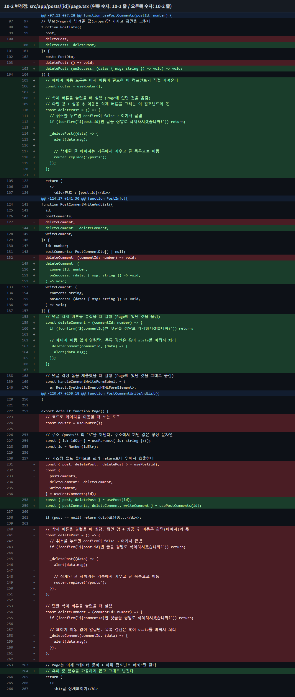

### 커밋 10-3: 훅 결과 객체를 통째로 넘기고 `ReturnType`으로 타입 지정 (41, 42강)

**변경 파일**: `src/app/posts/[id]/page.tsx`

10-2까지 `Page`는 훅 결과를 구조 분해해서 하나씩 꺼낸 다음, 하위 컴포넌트에 다시 하나씩 넘겼습니다. 하위 컴포넌트는 받은 함수의 타입을 훅과 똑같이 한 번 더 적어야 했습니다. 이번 커밋에서는 **훅 결과 객체를 통째로** 넘기고, 타입은 **`ReturnType<typeof 훅>`** 으로 훅에서 가져옵니다.

| | 10-2 | 10-3 |
|---|---|---|
| `Page`가 넘기는 것 | `post`, `deletePost`, `postComments`, `deleteComment`, `writeComment` (5개) | `postState`, `postCommentsState` (2개) + `id` |
| props 타입 | 함수 모양을 손으로 다시 적음 | `ReturnType<typeof usePost>` 한 줄 |
| 글 로딩 처리 (`post == null`) | `Page` | `PostInfo` |

#### 코드 상세 설명

> 줄 번호는 **10-3 커밋 시점의 `src/app/posts/[id]/page.tsx`** 기준입니다. 설명 앞의 **[숫자]** 가 그 설명이 가리키는 코드 줄입니다.

**① `Page`: 훅 결과를 객체 그대로 받아서 그대로 넘긴다 (251~273번 줄)**

```tsx
257  const postState = usePost(id);
258  const postCommentsState = usePostComments(id);
266      <PostInfo postState={postState} />
270      <PostCommentWriteAndList id={id} postCommentsState={postCommentsState} />
```

- **[257]** `usePost`는 33번 줄 `return { post, deletePost };`로 객체 하나를 돌려줍니다. 10-2에서는 `const { post, deletePost } = usePost(id);`로 꺼냈지만, 이제 꺼내지 않고 **객체째** `postState`에 담습니다.
- **[258]** `usePostComments`의 93번 줄 `return { postComments, deleteComment, writeComment };` 객체를 통째로 `postCommentsState`에 담습니다.
- **[266]** `PostInfo`에 객체 하나만 넘깁니다. 10-2의 `<PostInfo post={post} deletePost={deletePost} />`보다 짧아졌습니다.
- **[270]** 10-2에서 4개(`id`, `postComments`, `deleteComment`, `writeComment`)를 넘기던 것이 2개가 되었습니다. `id`는 훅 결과에 없어서 아직 따로 넘깁니다(10-4에서 정리).
- 10-2의 `if (post == null) return <div>로딩중...</div>;`가 `Page`에서 빠졌습니다. `Page`가 `post`를 꺼내지 않으니 검사할 수도 없고, 글을 그리는 `PostInfo`(107번 줄)가 맡습니다.
- 훅 결과에 값이 추가되어도(예: 11장의 `modifyComment`) `Page`는 고칠 필요가 없습니다. 객체째 넘기기 때문입니다.

**② `ReturnType<typeof usePost>`: 타입을 훅에서 가져온다 (99번 줄, 148번 줄)**

```tsx
 99  function PostInfo({ postState }: { postState: ReturnType<typeof usePost> }) {
148    postCommentsState: ReturnType<typeof usePostComments>;
```

- **[99]** 읽는 순서
  - `typeof usePost`: `usePost` **함수의 타입**입니다. "숫자를 받아서 `{ post, deletePost }`를 돌려주는 함수"라는 정보가 들어 있습니다.
  - `ReturnType<함수타입>`: 그 함수가 **돌려주는 값의 타입**만 꺼냅니다. 결과는 `{ post: PostDto | null; deletePost: (onSuccess: ...) => void }`입니다.
- **[99]** 10-2의 `deletePost: (onSuccess: (data: { msg: string }) => void) => void;`처럼 손으로 적던 타입이 사라졌습니다. 훅 23번 줄의 함수 모양이 바뀌면 이 타입도 **자동으로** 따라 바뀝니다.
- **[148]** `usePostComments`도 같습니다. 10-2의 `deleteComment`(4줄), `writeComment`(4줄) 타입이 이 한 줄로 바뀌었습니다.
- 강의(42강)에서 비교한 세 방식

| 방식 | 예 | 문제 |
|---|---|---|
| 타입 없음 | `{ postState }: any` | 오타나 없는 값을 써도 잡아 주지 않음 |
| 타입 직접 정의 | `type PostState = { post: ...; deletePost: ... }` | 훅이 바뀌면 같이 고쳐야 함 (10-2의 문제) |
| `ReturnType` | `ReturnType<typeof usePost>` | 훅에서 자동으로 가져옴 |

**③ `PostInfo`: 받은 객체에서 꺼내고, 로딩 처리도 맡는다 (99~139번 줄)**

```tsx
101    const router = useRouter();
104    const { post, deletePost: _deletePost } = postState;
107    if (post == null) return <div>로딩중...</div>;
111    const deletePost = () => {
```

- **[104]** 10-2에서 props 자리(`deletePost: _deletePost,`)에서 하던 구조 분해를 이제 **함수 본문에서** 합니다. 객체 하나를 받았으니 쓰기 전에 꺼내야 합니다. `_deletePost`로 이름을 바꾸는 이유는 같습니다(111번 줄에 버튼용 `deletePost`가 있음).
- **[107]** `post`의 타입이 이제 `PostDto | null`입니다(`ReturnType`에 `null`이 포함됨). 그래서 `Page`에 있던 로딩 처리를 여기로 옮겼습니다. 이 줄 아래에서는 `post`가 `null`이 아니므로 113번 줄 `post.id`를 쓸 수 있습니다.
- **[101]** `useRouter()`는 107번 줄의 조기 `return`보다 **위에** 있어야 합니다. 훅은 매번 같은 순서로 호출되어야 하는데, 아래에 두면 로딩 중일 때는 호출되지 않기 때문입니다(7-1 훅의 규칙).
- **[111~121]** 버튼용 `deletePost`는 10-2와 같습니다.

**④ `PostCommentWriteAndList`: 받은 객체에서 꺼낸다 (143~249번 줄)**

```tsx
143  function PostCommentWriteAndList({
144    id,
145    postCommentsState,
146  }: {
147    id: number;
148    postCommentsState: ReturnType<typeof usePostComments>;
149  }) {
151    const {
152      postComments,
153      deleteComment: _deleteComment,
154      writeComment,
155    } = postCommentsState;
```

- **[151~155]** 10-2에서 props 자리에서 하던 구조 분해를 함수 본문으로 옮겼습니다. 꺼낸 이름(`postComments`, `_deleteComment`, `writeComment`)이 10-2와 같으므로 **아래 코드는 한 줄도 바뀌지 않았습니다**.
- **[153]** `_deleteComment`로 이름을 바꾸는 이유는 158번 줄 버튼용 `deleteComment` 때문입니다(10-2와 같음).

**정리: 10-2에서 손으로 적던 타입이 어떻게 됐나**

| 10-2 (손으로 적음) | 10-3 |
|---|---|
| `post: PostDto;` + `deletePost: (onSuccess: ...) => void;` | 99번 줄 `ReturnType<typeof usePost>` |
| `postComments: PostCommentDto[] \| null;` + `deleteComment: (...)` 4줄 + `writeComment: (...)` 4줄 | 148번 줄 `ReturnType<typeof usePostComments>` |

**결과 화면**: 구조만 바꿔서 화면이 10-2와 같으므로(`docs/images/10-3.png`), 대신 **커밋 변경점**을 캡처했습니다. 왼쪽 숫자는 10-2 줄 번호, 오른쪽 숫자는 10-3 줄 번호입니다. 빨간 줄은 지운 줄, 초록 줄은 추가한 줄입니다.

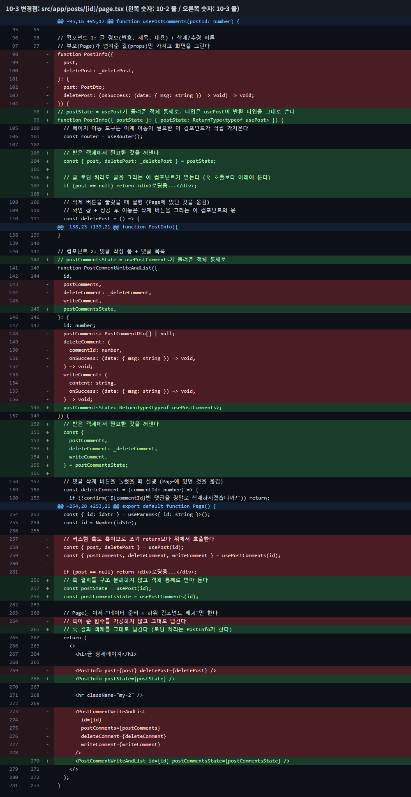

### 커밋 10-4: `PostCommentWrite`, `PostCommentList`로 분리, 훅이 `postId` 제공 (44, 46, 47강)

**변경 파일**: `src/app/posts/[id]/page.tsx`

10-3의 `PostCommentWriteAndList` 하나가 댓글 작성 폼과 댓글 목록을 모두 그렸습니다. 이것을 두 컴포넌트로 나누고, `PostCommentWriteAndList`는 둘을 **배치만** 하게 바꿨습니다. 또 `Page`가 `id`를 따로 넘기던 것을 없애고, 훅이 `postId`를 함께 돌려주게 했습니다.

| 컴포넌트 | 10-3 | 10-4 |
|---|---|---|
| `PostCommentWrite` (새로 생김) | | 댓글 작성 폼 + `handleCommentWriteFormSubmit` |
| `PostCommentList` (새로 생김) | | 댓글 목록 + 확인창 붙은 `deleteComment` |
| `PostCommentWriteAndList` | 폼과 목록을 모두 그림 | 위 두 컴포넌트를 배치만 함 |
| 글 번호 | `Page`가 `id={id}`로 따로 넘김 | 훅이 `postId`로 돌려줌 |

#### 코드 상세 설명

> 줄 번호는 **10-4 커밋 시점의 `src/app/posts/[id]/page.tsx`** 기준입니다. 설명 앞의 **[숫자]** 가 그 설명이 가리키는 코드 줄입니다.

**① 훅이 `postId`도 돌려준다 (37번 줄, 95번 줄) — 46강**

```tsx
 37  function usePostComments(postId: number) {
 95    return { postId, postComments, deleteComment, writeComment };
```

- **[37]** `usePostComments`는 처음부터 글 번호를 `postId`라는 매개변수로 받고 있었습니다. 훅 안의 `deleteComment`, `writeComment`가 주소를 만들 때 이 `postId`를 씁니다. 함수 안에서 바깥 변수를 기억해 쓰는 것을 **클로저**라고 합니다.
- **[95]** 10-3의 `return { postComments, deleteComment, writeComment };`에 `postId`를 추가했습니다. 훅이 **이미 알고 있는 값**이므로 같이 돌려주면, 하위 컴포넌트가 `postCommentsState.postId`로 꺼내 쓸 수 있습니다.
- 그래서 `Page`가 글 번호를 따로 넘길 필요가 없어졌습니다(⑤).
- 47강의 "`id` 대신 `postId`라는 이름"은 이미 7-2에서 매개변수 이름을 `postId`로 지어 두어서 이번에 따로 바꿀 것이 없습니다. 하위 컴포넌트에서도 `id`가 아니라 `postId`로 꺼내므로, 이것이 **글 번호**인지 **댓글 번호**인지 헷갈리지 않습니다.

**② `PostCommentWrite`: 댓글 작성 폼만 그린다 (143~207번 줄) — 44강**

```tsx
145  function PostCommentWrite({
146    postCommentsState,
147  }: {
148    postCommentsState: ReturnType<typeof usePostComments>;
149  }) {
151    const { postId, writeComment } = postCommentsState;
154    const handleCommentWriteFormSubmit = (
189        <h2>{postId}번 글에 대한 댓글 작성</h2>
```

- **[146~148]** 10-3과 같은 방식으로 훅 결과 객체를 통째로 받습니다. 타입도 `ReturnType`이라 95번 줄에 `postId`를 추가한 것이 자동으로 반영됩니다.
- **[151]** 폼에 필요한 `postId`와 `writeComment`만 꺼냅니다. `postComments`, `deleteComment`는 이 컴포넌트에서 쓰지 않으므로 꺼내지 않습니다.
- **[154~185]** `handleCommentWriteFormSubmit`은 10-3의 `PostCommentWriteAndList`에 있던 것을 그대로 옮겼습니다.
- **[189]** 10-3의 `<h2>{id}번 글에 대한 댓글 작성</h2>`가 `{postId}`로 바뀌었습니다. props `id` 대신 151번 줄에서 훅 결과로부터 꺼낸 값입니다.
- **[191~205]** 폼 JSX는 그대로 옮겼습니다.

**③ `PostCommentList`: 댓글 목록만 그린다 (209~259번 줄) — 44강**

```tsx
211  function PostCommentList({
212    postCommentsState,
213  }: {
214    postCommentsState: ReturnType<typeof usePostComments>;
215  }) {
216    const {
217      postId,
218      postComments,
219      deleteComment: _deleteComment,
220    } = postCommentsState;
223    const deleteComment = (commentId: number) => {
234        <h2>{postId}번 글에 대한 댓글 목록</h2>
```

- **[216~220]** 목록에 필요한 `postId`, `postComments`, `_deleteComment`만 꺼냅니다. `writeComment`는 쓰지 않으므로 꺼내지 않습니다.
- **[219]** `_deleteComment`로 이름을 바꾸는 이유는 223번 줄 버튼용 `deleteComment` 때문입니다(10-2와 같음).
- **[223~230]** 확인창 붙은 `deleteComment`는 삭제 버튼이 있는 이 컴포넌트로 따라왔습니다.
- **[234]** `{id}` → `{postId}`.
- **[236~257]** 로딩/없음/목록 세 가지 상태와 `map` 목록 JSX는 그대로 옮겼습니다.

**④ `PostCommentWriteAndList`: 배치만 한다 (261~277번 줄)**

```tsx
263  function PostCommentWriteAndList({
264    postCommentsState,
265  }: {
266    postCommentsState: ReturnType<typeof usePostComments>;
267  }) {
268    return (
269      <>
270        <PostCommentWrite postCommentsState={postCommentsState} />
272        <hr className="my-2" />
274        <PostCommentList postCommentsState={postCommentsState} />
275      </>
276    );
277  }
```

- **[264]** `id` props가 빠지고 `postCommentsState` 하나만 받습니다.
- **[270, 274]** 받은 객체를 두 하위 컴포넌트에 **그대로 다시 넘깁니다**. 각 컴포넌트가 필요한 것만 꺼내 씁니다(151번 줄, 216~220번 줄).
- **[272]** 폼과 목록 사이 구분선은 두 컴포넌트 **사이**에 있으므로 여기에 둡니다(10-1에서 `Page`에 `<hr>`을 남긴 것과 같은 이유).
- 이렇게 하면 `Page` → `PostCommentWriteAndList` → `PostCommentWrite`/`PostCommentList`로 같은 객체가 차례로 전달됩니다. 중간 컴포넌트는 내용을 몰라도 그냥 넘겨주기만 합니다.

**⑤ `Page`: `id`를 넘기지 않는다 (298번 줄)**

```tsx
286    const postCommentsState = usePostComments(id);
298        <PostCommentWriteAndList postCommentsState={postCommentsState} />
```

- **[286]** `id`는 훅을 부를 때 한 번만 넘깁니다. 훅이 기억해 두었다가 95번 줄에서 `postId`로 돌려줍니다.
- **[298]** 10-3의 `<PostCommentWriteAndList id={id} postCommentsState={postCommentsState} />`에서 `id={id}`가 빠졌습니다.

**결과 화면**: 구조만 바꿔서 화면이 10-3와 같으므로(`docs/images/10-4.png`), 대신 **커밋 변경점**을 캡처했습니다. 왼쪽 숫자는 10-3 줄 번호, 오른쪽 숫자는 10-4 줄 번호입니다. 빨간 줄은 지운 줄, 초록 줄은 추가한 줄입니다.

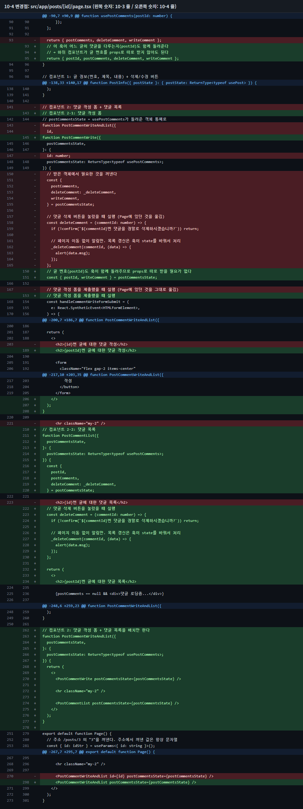

### 커밋 10-5: `PostCommentListItem` 분리 (48강)

**변경 파일**: `src/app/posts/[id]/page.tsx`

`PostCommentList`의 `map` 안에 있던 `<li>`(댓글 한 줄)를 `PostCommentListItem` 컴포넌트로 뺐습니다. 댓글 삭제 확인창 함수도 삭제 버튼을 따라 이 컴포넌트로 옮겼습니다.

| | 10-4 | 10-5 |
|---|---|---|
| 댓글 한 줄 `<li>` | `PostCommentList`의 `map` 안 | `PostCommentListItem` |
| 확인창 붙은 `deleteComment` | `PostCommentList` | `PostCommentListItem` |
| `PostCommentList`가 꺼내는 값 | `postId`, `postComments`, `_deleteComment` | `postId`, `postComments` |

#### 코드 상세 설명

> 줄 번호는 **10-5 커밋 시점의 `src/app/posts/[id]/page.tsx`** 기준입니다. 설명 앞의 **[숫자]** 가 그 설명이 가리키는 코드 줄입니다.

**① `PostCommentListItem`: 댓글 한 줄을 그린다 (210~244번 줄)**

```tsx
212  function PostCommentListItem({
213    comment,
214    postCommentsState,
215  }: {
216    comment: PostCommentDto;
217    postCommentsState: ReturnType<typeof usePostComments>;
218  }) {
219    const { deleteComment: _deleteComment } = postCommentsState;
222    const deleteComment = (commentId: number) => {
233      <li className="flex gap-2 items-center">
238          onClick={() => deleteComment(comment.id)}
```

- **[213, 216]** `comment: PostCommentDto`: 이 줄이 그릴 **댓글 하나**를 받습니다. 10-4에서는 `map((comment) => ...)`의 `comment` 변수를 `<li>` 안에서 바로 썼지만, 이제 다른 함수(컴포넌트)로 나갔으니 props로 받아야 합니다.
- **[214, 217]** 삭제 요청 함수를 쓰기 위해 훅 결과 객체도 받습니다.
- **[219]** 삭제 함수만 꺼냅니다. 이 컴포넌트는 `postId`나 `postComments`(목록 전체)가 필요 없습니다.
- **[222~229]** 확인창 붙은 `deleteComment`는 10-4의 `PostCommentList`에 있던 것을 그대로 옮겼습니다. 삭제 버튼(238번 줄)이 이제 여기 있으니 함께 따라왔습니다.
- **[233~242]** `<li>` JSX는 10-4와 같습니다. 단, `key={comment.id}`가 빠졌습니다(②).

**② `PostCommentList`: 목록 틀만 그리고, 한 줄은 맡긴다 (246~279번 줄)**

```tsx
253    const { postId, postComments } = postCommentsState;
267            {postComments.map((comment) => (
268              <PostCommentListItem
269                key={comment.id}
270                comment={comment}
271                postCommentsState={postCommentsState}
272              />
273            ))}
```

- **[253]** 10-4의 `const { postId, postComments, deleteComment: _deleteComment } = postCommentsState;`에서 `_deleteComment`가 빠졌습니다. 삭제는 이제 `PostCommentListItem`이 맡습니다.
- **[268~272]** `map`이 댓글마다 `<li>` 대신 `<PostCommentListItem />`을 만듭니다. 댓글이 3개면 `PostCommentListItem` 함수가 3번 호출됩니다.
- **[270]** 그 줄이 그릴 댓글 하나를 넘깁니다. **[271]** 받은 훅 결과 객체를 그대로 다시 넘깁니다.
- **[269]** `key`는 **`map` 안에서, 바깥쪽 태그에** 붙입니다. React는 `map`이 만든 형제들 중 누가 누군지 `key`로 구분합니다. 이제 형제가 `<PostCommentListItem>`들이므로 여기에 붙입니다. `key`는 React가 쓰는 표식이라 props로 넘어가지 않습니다(`PostCommentListItem`에서 `key`를 꺼낼 수 없음).

**왜 한 줄을 컴포넌트로 빼나?**

- 다음 11장(댓글 수정)에서 댓글마다 "수정 모드인지 아닌지"를 기억해야 합니다. `useState`는 컴포넌트 함수의 맨 위에서만 부를 수 있어서 `map` 안에서는 쓸 수 없습니다. 댓글 한 줄이 컴포넌트가 되면 그 안에서 `useState`를 써서 **댓글마다 따로** 상태를 가질 수 있습니다.

**결과 화면**: 구조만 바꿔서 화면이 10-4와 같으므로, 대신 **커밋 변경점**을 캡처했습니다. 왼쪽 숫자는 10-4 줄 번호, 오른쪽 숫자는 10-5 줄 번호입니다. 빨간 줄은 지운 줄, 초록 줄은 추가한 줄입니다.

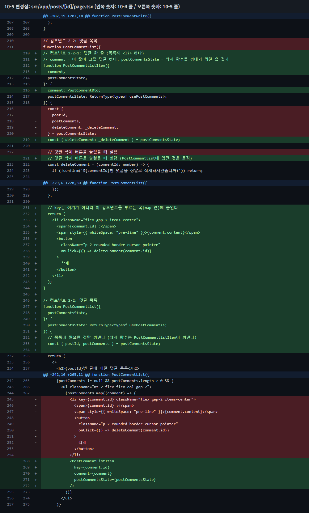

---

## 마무리

| 기능 | 커밋 | 핵심 개념 |
|---|---|---|
| 1. 홈 | 1-1, 1-2 | `layout.tsx`와 `{children}`, `Link` |
| 2. 글 다건조회 | 2-1 ~ 2-3 | `.env`, 타입, `useState`, `useEffect`, `fetch`, 공용 함수 `apiFetch` |
| 3. 글 단건조회 | 3-1, 3-2 | 동적 경로 `[id]`, `useParams`, 의존성 배열, `res.ok`와 `.catch` |
| 4. 글 삭제 | 4-1, 4-2 | `onClick`, `confirm`, `DELETE`, `useRouter`와 `replace` |
| 5. 글 작성 | 5-1 ~ 5-3 | `onSubmit`, `preventDefault`, 입력 검사, `POST`, `JSON.stringify`, `Content-Type` |
| 6. 글 수정 | 6-1, 6-2 | `defaultValue`, `PUT` |
| 7. 댓글 다건조회 | 7-1, 7-2 | 훅의 규칙, 커스텀 훅, 콜백 |
| 8. 댓글 삭제 | 8-1 | `filter`로 state 갱신 |
| 9. 댓글 작성 | 9-1, 9-2 | 전개 문법 `[...arr, x]`로 state 갱신 |
