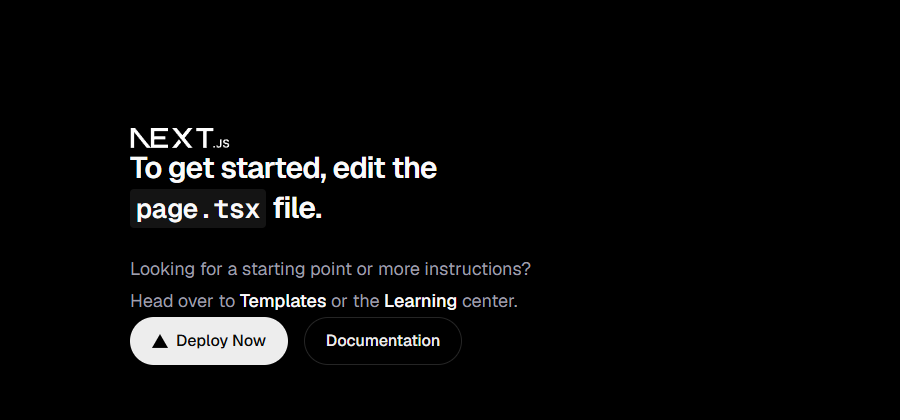

# p-14175-2 스프링부트 REST API + Next.js 게시판

- 수업: https://www.slog.gg/p/14175
- 참고 코드: [jhs512/p-14175-2](https://github.com/jhs512/p-14175-2)
- 백엔드: [jhs512/p-14172-2](https://github.com/jhs512/p-14172-2)의 `068` 태그 (Spring Boot, `http://localhost:8080`)
- 프론트엔드: Next.js 16 (App Router), TypeScript, Tailwind CSS (`http://localhost:3000`)

## 실행 방법

### 백엔드 (터미널 1)

```powershell
git clone https://github.com/jhs512/p-14172-2.git p-14172-2-backend
cd p-14172-2-backend
git checkout 068
./gradlew bootRun
```

- 068 백엔드에는 `localhost:3000`에서 오는 요청을 허용하는 CORS 설정(`WebMvcConfig`)이 이미 들어 있습니다.

### 프론트엔드 (터미널 2)

```powershell
pnpm install
pnpm dev
```

브라우저에서 http://localhost:3000 을 엽니다.

## 사용하는 백엔드 API

| 기능 | 메서드 | 주소 |
|---|---|---|
| 글 다건조회 | `GET` | `/api/v1/posts` |
| 글 단건조회 | `GET` | `/api/v1/posts/{id}` |
| 글 삭제 | `DELETE` | `/api/v1/posts/{id}` |
| 글 작성 | `POST` | `/api/v1/posts` |
| 글 수정 | `PUT` | `/api/v1/posts/{id}` |
| 댓글 다건조회 | `GET` | `/api/v1/posts/{postId}/comments` |
| 댓글 삭제 | `DELETE` | `/api/v1/posts/{postId}/comments/{id}` |
| 댓글 작성 | `POST` | `/api/v1/posts/{postId}/comments` |

## 진행 방식

기능 하나를 여러 커밋으로 나눠서 구현합니다. 커밋마다 바뀐 파일과 핵심 개념을 아래에 정리합니다.
커밋마다 브라우저 화면을 캡처해서 **전(이전 커밋) / 후(이 커밋)** 로 붙였습니다(`docs/images/`).

1. 홈
2. 글 다건조회
3. 글 단건조회
4. 글 삭제
5. 글 작성
6. 글 수정
7. 댓글 다건조회
8. 댓글 삭제
9. 댓글 작성

---

## 0. 프로젝트 생성

### 커밋 0-1: create-next-app으로 프로젝트 생성

```powershell
pnpm create next-app@16.4.6 p-14175-2 --ts --tailwind --eslint --app --src-dir --import-alias "@/*" --use-pnpm --react-compiler
```

| 옵션 | 의미 |
|---|---|
| `--ts` | TypeScript 사용 |
| `--tailwind` | 클래스 이름만으로 스타일을 주는 Tailwind CSS 사용 |
| `--eslint` | 코드 규칙 검사 도구 ESLint 사용 |
| `--app` | App Router 사용: `src/app` 폴더 구조가 곧 주소가 됨 |
| `--src-dir` | 소스 코드를 `src/` 아래에 둠 |
| `--import-alias "@/*"` | `@/lib/...`처럼 `src/` 기준으로 import 가능 |

**주요 파일**

| 파일 | 역할 |
|---|---|
| `src/app/layout.tsx` | 모든 페이지를 감싸는 공통 틀(`<html>`, `<body>`) |
| `src/app/page.tsx` | `/` 주소의 페이지 |
| `src/app/globals.css` | 전체 CSS. Tailwind를 불러옴 |
| `package.json` | 사용하는 라이브러리와 실행 명령(`pnpm dev` 등) |

**결과 화면** (`/`): create-next-app 기본 화면



### 커밋 0-2: README 작성

과제 개요, 실행 방법, 사용할 백엔드 API 목록을 정리했습니다.

**결과 화면**: README만 바꿨으므로 화면 변화 없음

---

## 1. 홈

### 커밋 1-1: 공통 레이아웃에 상단 메뉴 추가

**변경 파일**: `src/app/layout.tsx`

- `layout.tsx`는 **모든 페이지를 감싸는 틀**입니다. 각 페이지(`page.tsx`)의 내용은 `{children}` 자리에 들어갑니다. 그래서 여기에 넣은 메뉴는 어느 페이지에서나 보입니다.
- 화면 구조: `<header>`(메뉴) → `<main>`(페이지 내용) → `<footer>`(푸터)
- `<Link href="/posts">`: Next.js의 링크 컴포넌트입니다. 일반 `<a>` 태그와 달리 페이지 전체를 새로 불러오지 않고 바뀐 부분만 바꿔서 빠르게 이동합니다.
- `metadata`: 브라우저 탭에 보이는 제목(`title`)과 설명을 정합니다.
- `lang="ko"`: 페이지 언어를 한국어로 알립니다.
- Tailwind 클래스 예시
  - `flex`: 자식 요소를 가로로 나란히 놓음
  - `p-2`: 안쪽 여백, `rounded`: 모서리 둥글게, `hover:bg-gray-100`: 마우스를 올리면 회색 배경
  - `flex-grow`: `<main>`이 남는 세로 공간을 모두 차지해서 푸터가 화면 맨 아래로 내려감

**결과 화면**

| 전 | 후 |
|---|---|
|  |  |
| `/` 기본 화면 | `/` 위에 "메인 / 글 목록" 메뉴가 생김 |

### 커밋 1-2: 홈 페이지를 "안녕하세요."로 단순화

**변경 파일**: `src/app/page.tsx`

- create-next-app이 만든 기본 소개 화면을 지우고, 가운데에 "안녕하세요."만 보여 주는 홈으로 바꿨습니다.
- 컴포넌트 구조가 한눈에 보입니다: `export default function Page()` → `return (JSX)`
- 이 페이지의 `<div>`가 `layout.tsx`의 `{children}` 자리에 들어갑니다.
- Tailwind 클래스
  - `flex-grow`: `<main>`의 남는 공간을 모두 차지함
  - `flex items-center justify-center`: 내용을 세로·가로 가운데에 놓음
- 기본 화면에서만 쓰던 `next/image`와 `public/` 안의 이미지 import도 함께 사라졌습니다.

**결과 화면**

| 전 | 후 |
|---|---|
|  |  |
| `/` 메뉴 + 기본 화면 | `/` 메뉴 + 안녕하세요. + 푸터 |

---

## 2. 글 다건조회

### 커밋 2-1: 백엔드 주소(.env)와 글 타입(PostDto) 정의

**변경 파일**

| 파일 | 역할 |
|---|---|
| `.env` (새 파일) | `NEXT_PUBLIC_API_BASE_URL=http://localhost:8080` 백엔드 주소 |
| `src/type/post.ts` (새 파일) | 백엔드가 돌려주는 글 데이터의 모양(`PostDto` 타입) |
| `.gitignore` | `!.env` 한 줄 추가 |

**`.env`: 환경 변수 파일**

- 백엔드 주소를 코드 여러 곳에 직접 쓰면, 주소가 바뀔 때 전부 찾아 고쳐야 합니다. `.env` 한 곳에 두고 코드에서는 `process.env.NEXT_PUBLIC_API_BASE_URL`로 읽습니다. 스프링의 `application.yml`과 비슷한 역할입니다.
- 이름이 `NEXT_PUBLIC_`으로 시작해야 브라우저에서 실행되는 코드에서도 읽을 수 있습니다.
- 브라우저에 그대로 보이는 값이라 비밀번호 같은 비밀값은 넣으면 안 됩니다.
- create-next-app의 `.gitignore`는 `.env*`를 전부 커밋에서 뺍니다. 이 파일에는 비밀값이 없으므로 `!.env`(예외: 이 파일은 커밋함)를 추가했습니다.

**`PostDto` 타입: 데이터 모양 약속**

- 백엔드 `GET /api/v1/posts`의 응답 예시

  ```json
  [{ "id": 1, "createDate": "2026-...", "modifyDate": "2026-...", "title": "제목 1", "content": "내용 1" }]
  ```

- `type PostDto = { ... }`로 이 모양을 적어 두면, `post.titel`처럼 오타를 내거나 없는 필드를 쓸 때 TypeScript가 바로 빨간 줄로 알려 줍니다.
- 백엔드 Java record와 비교

  | Java (`PostDto`) | TypeScript |
  |---|---|
  | `int id` | `id: number` |
  | `LocalDateTime createDate` | `createDate: string` (JSON에서는 날짜가 문자열로 옴) |
  | `String title` | `title: string` |

- `export`를 붙여서 다른 파일에서 `import type { PostDto } from "@/type/post"`로 가져다 씁니다.
- 아직 이 타입을 쓰는 화면은 없습니다. 다음 커밋에서 사용합니다.

**결과 화면**: 설정과 타입만 추가했으므로 화면 변화 없음

### 커밋 2-2: `/posts` 페이지에서 글 목록 받아와 출력

**변경 파일**: `src/app/posts/page.tsx` (새 파일) → 주소 `/posts`

**동작 순서**

```
1. 첫 화면: posts가 null → "로딩중..." 표시
2. 화면이 그려진 직후 useEffect 실행 → fetch로 백엔드 GET /api/v1/posts 요청
3. 응답 JSON을 setPosts(글 목록)로 저장
4. state가 바뀌었으므로 React가 Page()를 다시 실행 → 이번엔 글 목록 표시
```

**핵심 개념**

- `"use client"`: 이 파일은 **브라우저에서 실행**되는 컴포넌트라는 표시입니다. `useState`, `useEffect`는 브라우저에서만 동작하므로 꼭 필요합니다.
- `useState`: 화면에 쓰이는 **값을 기억하는 상자**입니다.
  - `const [posts, setPosts] = useState<PostDto[] | null>(null);`
  - `posts`는 현재 값, `setPosts`는 값을 바꾸는 함수, `(null)`은 처음 값입니다.
  - `<PostDto[] | null>`: "글 배열이거나 null"이라는 타입입니다. `|`는 "또는"입니다.
  - 일반 변수를 바꾸면 화면이 그대로지만, **`setPosts`로 바꾸면 React가 화면을 다시 그립니다.**
- `useEffect(() => { ... }, [])`: 화면이 그려진 **뒤에** 실행할 코드입니다. 두 번째 인자 `[]`(빈 배열)는 "처음 한 번만 실행"이라는 뜻입니다. 백엔드 요청처럼 시간이 걸리는 일을 여기서 합니다.
- `fetch(주소)`: 브라우저에 내장된 HTTP 요청 함수입니다. 응답이 바로 오지 않으므로 `.then(...)`으로 "응답이 오면 할 일"을 이어 붙입니다.
  - `.then((res) => res.json())`: 응답 본문을 JSON으로 해석
  - `.then(setPosts)`: 해석한 글 목록을 state에 저장 (`.then((data) => setPosts(data))`의 줄임)
- `` `${process.env.NEXT_PUBLIC_API_BASE_URL}/api/v1/posts` ``: 2-1에서 만든 `.env` 값으로 주소를 만듭니다.

**화면 그리기 문법 (JSX)**

- `if (posts == null) return <div>로딩중...</div>;`: 아직 응답이 안 왔으면 여기서 끝냅니다. 이 줄 아래에서는 `posts`가 null이 아니라고 TypeScript가 알아서 판단합니다.
- `<> ... </>`: 이름 없는 묶음 태그(Fragment)입니다. JSX는 최상위 태그가 하나여야 하는데, 쓸데없는 `<div>`를 추가하고 싶지 않을 때 씁니다.
- `{조건 && <태그/>}`: 조건이 참일 때만 태그를 보여 줍니다. JSX 안에서는 `if`를 쓸 수 없어서 이렇게 씁니다.
- `posts.map((post) => <li>...</li>)`: 글 배열을 `<li>` 배열로 바꿔서 목록을 그립니다. Java Stream의 `map`과 같습니다.
- `key={post.id}`: 목록의 각 항목을 구분하는 이름표입니다. React가 어떤 항목이 바뀌었는지 알아내는 데 씁니다. 빠뜨리면 경고가 나옵니다.
- `<Link href={`/posts/${post.id}`}>`: 제목을 누르면 `/posts/1` 같은 상세 주소로 갑니다. 상세 페이지는 3번 기능에서 만듭니다.

**확인 방법**: 백엔드(`localhost:8080`)를 켠 상태에서 `pnpm dev` → 상단 메뉴 "글 목록"

**결과 화면**

| 전 | 후 |
|---|---|
|  |  |
| `/posts` 페이지가 없어서 404 | `/posts` 백엔드에서 받은 글 목록 |

> **주의: "Failed to fetch"가 뜰 때**
> 3000 포트를 다른 프로그램이 쓰고 있으면 `pnpm dev`가 3001 포트로 뜹니다. 백엔드 CORS 설정은 `localhost:3000`만 허용하므로 요청이 거절되고, 브라우저는 이유 없이 "Failed to fetch"만 보여 줍니다. 터미널에 `Local: http://localhost:3000`이 나오는지 확인하세요.

### 커밋 2-3: 백엔드 호출을 공용 함수 `apiFetch`로 분리

**변경 파일**

| 파일 | 내용 |
|---|---|
| `src/lib/backend/client.ts` (새 파일) | 공용 함수 `apiFetch` |
| `src/app/posts/page.tsx` | `fetch(...)` 3줄 → `apiFetch(...)` 1줄 |

**왜 분리하나?**

앞으로 글 단건조회, 삭제, 작성, 수정, 댓글까지 페이지마다 백엔드를 부릅니다. 그때마다 아래 두 가지를 반복하게 됩니다.

1. 주소 앞에 `process.env.NEXT_PUBLIC_API_BASE_URL` 붙이기
2. `.then((res) => res.json())`로 응답을 JSON으로 바꾸기

이 반복을 함수 하나로 모았습니다. 스프링에서 여러 컨트롤러가 공통으로 쓰는 코드를 서비스나 유틸 클래스로 빼는 것과 같은 이유입니다.

**전후 비교**

```tsx
// 전
fetch(`${process.env.NEXT_PUBLIC_API_BASE_URL}/api/v1/posts`)
  .then((res) => res.json())
  .then(setPosts);

// 후
apiFetch(`/api/v1/posts`).then(setPosts);
```

**`apiFetch` 읽는 법**

- `export const apiFetch = (url: string, options?: RequestInit) => { ... }`: 화살표 함수(`=>`)를 상수에 담은 것입니다. `function apiFetch(...) { ... }`와 같은 뜻입니다.
- `url: string`: `/api/v1/posts`처럼 주소 뒷부분만 받습니다.
- `options?: RequestInit`: `?`는 "생략 가능"이라는 뜻입니다. 지금은 GET만 쓰므로 생략하고, 나중에 삭제(`DELETE`)·작성(`POST`)에서 `{ method: "DELETE" }` 같은 옵션을 넘깁니다. `RequestInit`은 `fetch`가 받는 옵션의 타입입니다.
- `return fetch(...).then((res) => res.json())`: JSON으로 바꾼 결과를 돌려주므로, 부르는 쪽에서 `.then(setPosts)`처럼 바로 이어 쓸 수 있습니다.

**결과**: 화면은 2-2와 똑같습니다. 동작은 그대로 두고 코드 구조만 바꾸는 것을 **리팩터링**이라고 합니다.

**결과 화면**

| 전 | 후 |
|---|---|
|  |  |
| `/posts` (fetch 직접 사용) | `/posts` (apiFetch 사용) 화면 동일 |
